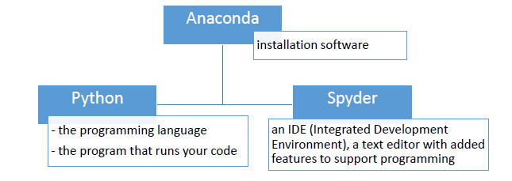
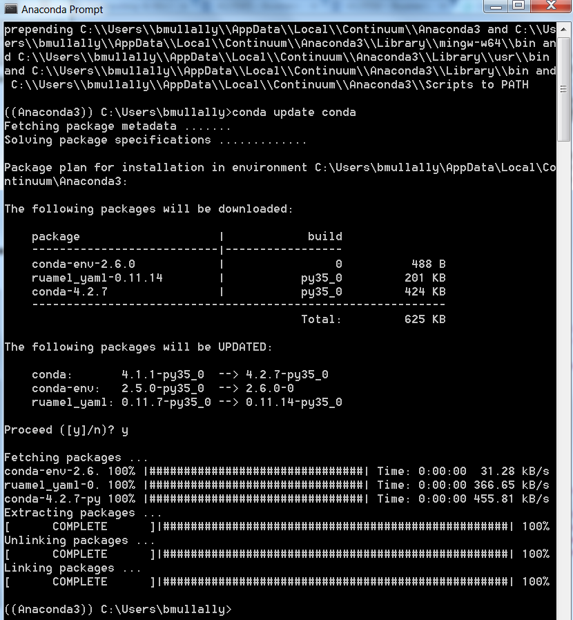

### 2. Introduction to Python using Spyder

Python is a programming language, and you'll be writing your Python code in the programming environment called Spyder. The Anaconda distribution simplifies the installation process by including Python, Spyder, and other packages and tools in one installation.

#### Installing Anaconda

- Go to <http://anaconda.com/products/distribution>
- Choose the download appropriate for your operating system.

- Save the file to your computer.
- Double click on the downloaded file to open it.
- Follow the on screen instructions, leaving options as they are currently set. This finishes the installation process.
- Next check for updates using Conda, which is one of the extras that is installed as part of the Anaconda distribution. It handles things like updates, set-up, and package installation through a command line interface. If there are many updates this can take 10 minutes or more.

**The following screenshots may have different package version to what show for you, versions are constantly being updated so these go out of date quickly.**

#### Windows
- Open Anaconda Command Prompt by typing Anaconda in the search box in the start menu.
- Type "conda update conda" at the command prompt, typing "y" for Yes and then pressing enter when it asks you to proceed. Your installation may identify different packages that you need updated.

- After that completes, you can then close the command prompt window.

#### MAC
- Open Terminal.
- Type "conda update conda" at the command prompt, typing "y" for Yes and then pressing enter when it asks you to proceed. Your installation may identify different packages that you need updated.

- After that compeltes, you can then close the command prompt window.
