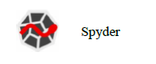
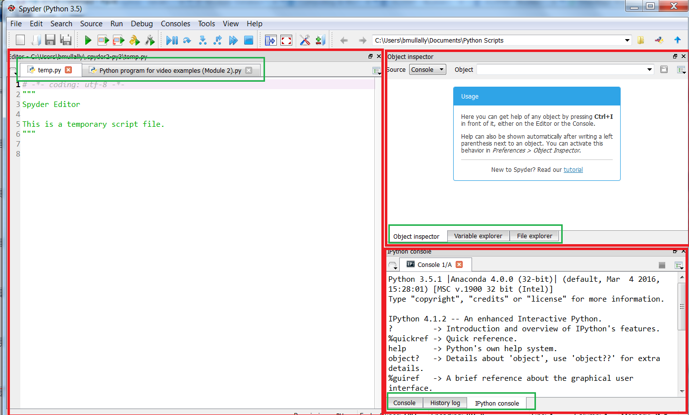
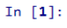

### 3. Getting to know Spyder

You will write your programs and run them inside the Spyder IDE.

On Windows, in the search box on the start menu, type Spyder. Click on the program.
On a Mac, use Spotlight to find the program Launcher. Click Launch on the Spyder-app entry.

After Spyder has launched you should see an interface that is organised into multiple windows (marked with red rectangles below) each of which has multiple tabs (marked with green rectangles below).

Your version may look different with a darker theme but the interface functions are the same. It may also ask if you wish to do the Introduction Tour, this is a good idea and will help you get familiar with the interface. I have also detailed the functionality below:

The default screen has three windows visible: Editor, Inspector, and Console.
If you accidently close a window or change the layout, you can revert to the default by clicking "View" on the menu bar and then clicking "Use Previous Layout" or in "Panes" choose the pane you just accidently closed.

- **Editor:** where you write and save sequences of commands, essentially where you will write your full program. In the sample that shows in the editor, anything after # is a comment, meaning that Python will ignore that text. Three double quotation marks are a special type of comment that spans multiple lines.

- **Console:** where Python runs your code.  Spyder offers two choices for a console, a basic one and an IPython (Interactive Python) console. It is the IPython console we want to use. The prompt (where you can type in a command) for an IPython console is :

- **Object Inspector:** On starting Spyder, the object inspector just gives you a link to the tutorial (this can be useful if you want to know more details about using Spyder). The rest of the time, this window will continue to give you information about a function such as the documentation from the help files and tells you what parameters the function takes.

- **Variable Explorer:** shows you the value and type of any variables you have created. This is useful when you are trying to debug your code.

- If you would like to find out more you can go to the help menu and choose Tutorial videos.

