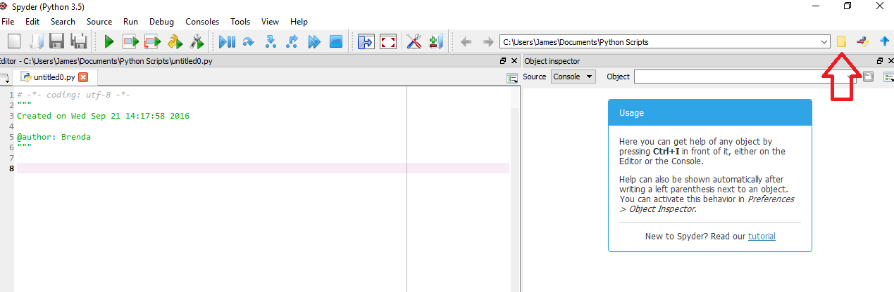
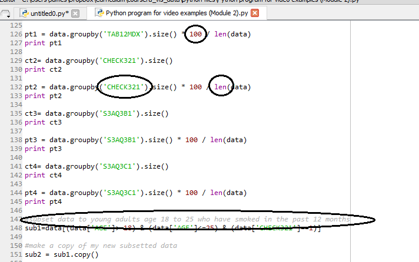
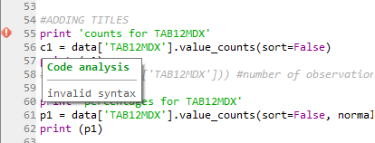
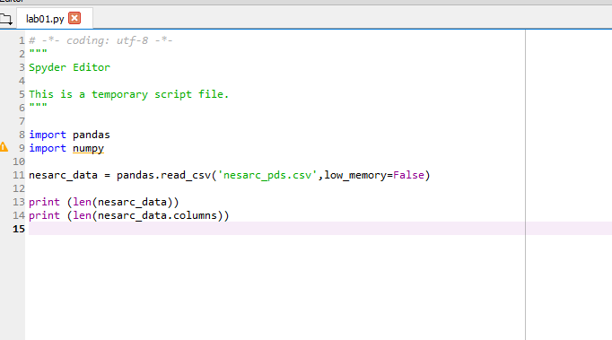
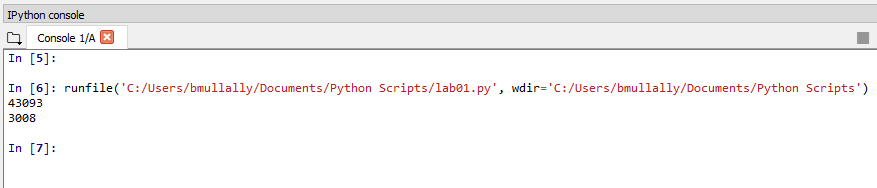

### 4. Editing

The first task is to set your working directory. This is done by clicking on the folder icon in the top right corner above the object inspector.



Browse to the folder where you wish to keep all of your python files and data files. This is the folder from which python files are executed and where you can import and run data sets. It is called the working directory.

The program/script editor works similar to other editors that colour code your program to help you write and debug it.

- Blue font indicates a Python keyword.
- Dark red are for numbers.
- Green is used for strings.
- Purple is used for a value in an option value pair or is a function.
- Grey font indicates comments about the program.



- Strings in Python consists of alphanumeric or other characters enclosed by single or double quotation marks.

- Comments start with a number sign `#` or a `£` symbol and they are not analysed by Python.

- If you write a line of code that is incorrect, you will probably be provided with an exclamation point and a red circle to the left of a line or lines of code. Hovering over the exclamation point with your mouse provides code analysis and helps you to debug your program.

- Sometimes the analysis is helpful and other times it simply indicates that you have written invalid syntax.

- Python is case sensitive, so be sure to always use the correct capitalisation when you write your programs.




#### 4.1 Writing your first program

For the first line of your Python program, you will need to import libraries that you will be using to conduct data analysis. Common libraries used for data analysis in Python include Pandas and NumPy.

```py

import pandas
import numpy

```

In the blank editor type in these two import statements.

Libraries, sometimes called packages, are collections of Python functions that others have written to add on to the basic functionality that is built into Python.

**Next are a few basic steps that all statistical packages require when you begin to write a program.**

First you will load the data that you'll be working with, which is the common form of a comma separated values file and has the extension .csv. This step is also sometimes called reading in or calling in the data set.

- To load in data you first must download the file.

- [nesarc file](./archives/nesarc_pds.zip)

- Save the file into the working directory you setup in this step (the place where your python files and datasets will be stored).

- Enter the following code to load the data file:

```py

nesarc_data = pandas.read_csv('nesarc_pds.csv', low_memory=False)

```

- **nesarc\_data** is the name I have chosen to call our data frame (Python object). You can call it anything you wish, throughout this and future labs we will use the name nesarc\_data.
- We set the data frame equal to the function **pandas.read\_csv** to tell python that we will be reading in a .csv file using the Pandas library.In Python function names are followed by a set of ().

- The name of the data file **nesarc_pds.csv** is included within the parenthesis, and also within either single or double quotation marks. The name of the data set must match exactly the actual file name. The file must also be located in the same working directory as the .py python file you are executing.

- It is a good idea to add parameter **low\_memory** and set it to false. Without this it is common to get a warning when you run your program because Pandas tries to determine what data type to set for each variable by analyzing the data in each column, this uses a lot of memory. Setting this parameter can increase efficiency when running the program. However it does mean that we will have to later ensure our data has the correct datatype.All of the code you write after this line will use this data set.

- Save the program by choosing File->Save. The default name is Untitled but you should rename it Lab01. It will be saved to the working directory.

---
- Add the following code and we can see the number of observations (rows) in the data set, and the number of variables (columns).

```py
print (len(nesarc_data)) #number of observations (rows)
print (len(nesarc_data.columns)) # number of variables (columns)
```



- Save and run this program by clicking on the Run button. Once these lines of code have run we will from now on highlight sections of code and choose "run selection or current line" within the Run menu or press F9.

- You can see here that Nesarc includes 43,093 observations (individual participants) with 3,008 variables.



- Some other useful lines of code to include are as follows (explanations of what the code does is included in the comment):

```py
#set PANDAS to show all columns in Data frame
pandas.set_option('display.max_columns', None)

#convert all columns names to uppercase
nesarc_data.columns = map(str.upper, nesarc_data.columns)

#display the datatypes within the dataset
print(nesarc_data.dtypes)

#display the general information of a dataset
nesarc_data.info()

#output the first 5 rows of data
nesarc_data.head()

```

- Once you have added these lines and saved the file, run the code again.
