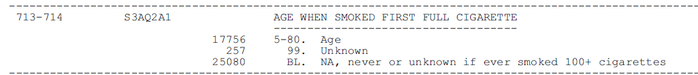

### 5. Frequency distribution

For a lot of data analysis there are specific questions or hypothesis that we want to test in our data.

- For this first analysis lab on the Nesarc data we are interested in looking at the association between how much a person smokes, that is the quantity and frequency of smoking, and the presence or absence of nicotine dependence.

- To investigate this we need to look in detail at the code book for the nesarc data set.

- [NESARC Code Book](./archives/NESARC-Code-Book.pdf)

- Save this document to the same working directory as your lab01.py file.

- This document contains a table of contents that sets out the different sections of interest within the dataset. For this lab we will be looking at section 3A or page 82 for Tobacco use and dependence. It describes each variable associated to Tobacco use and dependence. The final section of the code book also provides information on diagnosis such as nicotine dependence.

- It is the name of the variable (e.g. S3AQ1A) we are interested in rather than the longer descriptive name (e.g. Ever Smoked 100+ Cigarettes). For each variable the code book also shows you the counts for each possible value per variable. For example for S3AQ2A the possible values are from 5 to 80, 99 means an unknown age, and BL or blank is not applicable or unknown.

- To generate frequency distributions we can use the value counts function or the groupby function. They are part of the Panda's library. We always need to load this library each time you run Python in order to use the function. We have done this already in the first line of the program.

- First we output a message to the command line using the print() function, this helps us to label and put header information on our outputs.
- Next we use the **value\_counts** function to generate frequency counts for the nicotine dependence in the last 12 months variable (TAB12MDX):

~~~py
#Count and percentage for each variable using value_counts function

#Count the frequency of each value (0 or 1) in the TAB12MDX variable
print('counts for TAB12MDX - nicotine dependence in the past 12 months, yes=1')
print(nesarc_data['TAB12MDX'].value_counts(sort=False))
~~~

- Functions allow settings to be specified inside the parenthesis(), this function includes **sort=False** so that the data is sorted in the order of the original values rather than by the actual counts.

- This statement uses the **value\_counts** function to generate a frequency count for the variable called TAB12MDX in the **nesarc\_data** set.
- Each variable only exists as part of a data set so we must tell python what data set we are analysing, in this cases **nesarc\_data** and the variable is named within quotes within square brackets **['TAB12MDX']**.
- Dot notation should be familiar to you and nested function calls such as calling print and passing in the function call to value counts.

**The same output can be achieved using the groupby function:**

~~~py
#same outcome using the groupby funciton
print('groupby of TAB12MDX nicotine dependence in the past 12 months, yes=1')
print (nesarc_data.groupby('TAB12MDX').size())

~~~

We are used to seeing frequencies/counts of the values occurring in our variables. It is also nice to see percentages to get a clear picture.
To get percentages for each value based on those counts. The code is similar, we can include the setting normalize=True within the functions parenthesis separated by a comma.

~~~py
#percentage output for TAB12MDX
print('percentages for TAB12MDX - nicotine dependence in the past 12 months, yes=1')
print(nesarc_data["TAB12MDX"].value_counts(sort=True, normalize=True))

~~~

To get the same output for percentages using groupby: We must include arithmetic to multiply by 100 and divide by the number of rows (len(nesarc_data)) to calculate the percentage.

~~~py
#percentage for TAB12MDX using the groupby function
print('percentage of TAB12MDX nicotine dependence in the past 12 months, yes=1')
print(nesarc_data.groupby('TAB12MDX').size() * 100 / len(nesarc_data))

~~~
To get counts or percentages for each variable we are interested in separate lines of code need to be written for the moment. Like all programming languages python can use loops and functions for the purposes of doing the same piece of work multiple times. But for now you will learn the necessary python code to output analysis. Later there is some time for writing more efficient code such as functions/loops/conditional statements etc.

Save and run this program.

You can confirm  the correct counts by looking in the code book for the variable TAB12MDX (page 475).

#### Exercises

Now write the code necessary to find the counts and percentages for the following variables:

- CHECK321
- S3AQ3B1
- S3AQ3C1

Read in your code book to see what these variables relate to.

From the File menu choose Save and then Run from the Run menu.
