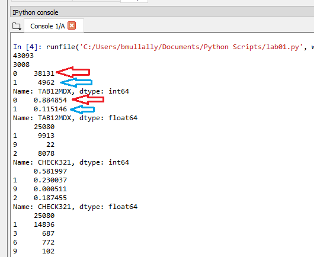
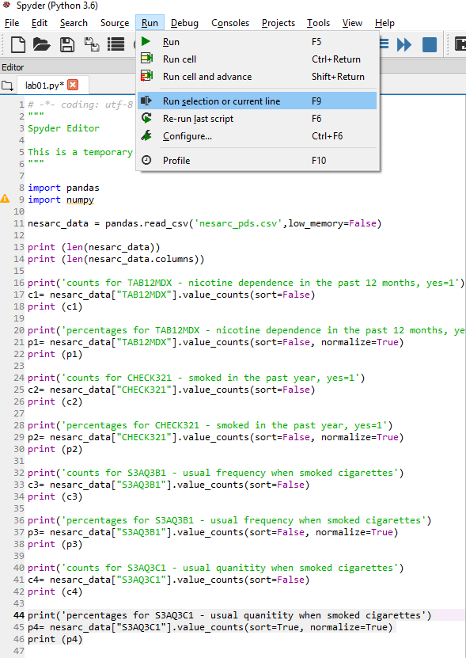
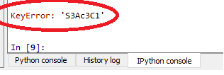

### 6. Frequencies

Your code from the previous step should look like this:

~~~py
#Count and percentage for each variable using value_counts function

print(nesarc_data["TAB12MDX"].value_counts(sort=True))
#percentage output for TAB12MDX
print(nesarc_data["TAB12MDX"].value_counts(sort=True, normalize=True))

#same outcome using the groupby funciton
print (nesarc_data.groupby('TAB12MDX').size())
#percentage for TAB12MDX using the groupby function
print(nesarc_data.groupby('TAB12MDX').size() * 100 / len(nesarc_data))

print(nesarc_data["CHECK321"].value_counts(sort=True))

print(nesarc_data["CHECK321"].value_counts(sort=True, normalize=True))

print(nesarc_data["S3AQ3B1"].value_counts(sort=True))

print(nesarc_data["S3AQ3B1"].value_counts(sort=True, normalize=True))

print(nesarc_data["S3AQ3C1"].value_counts(sort=True))

print(nesarc_data["S3AQ3C1"].value_counts(sort=True, normalize=True))

~~~

#### Readability of Output

When you run this code the distribution counts and percentages will be displayed in the console window. It is not very easy to determine one variable from the next. Our variables names are a bit cryptic and thus we might want our print statements to be clear and explain the analysis. The print function in our code is just asking for the text strings, we can change them to read however we would like.

For variable TAB12MDX nicotine dependence in the past 12 months the code book tells us that one means yes and zero means no. We can see in our counts that we have 38,131 respondents that have no nicotine dependence, when we look at the percentages output that is  88.4% of the sample. While 4,962 or approximately 11.5% of respondents do have a nicotine dependence.

To help with the output for the reader it is useful to place a further print line of code before the counts and percentages are printed.

~~~py
print('counts for TAB12MDX - nicotine dependence in the past 12 months, yes=1')
~~~

This line of code should be placed just before the first line seen above. Do this now for each variable, use the code book to find the long description for each variable.

Save your work. Test this by highlighting just the last three lines of code and choose run selection or current from the run menu.

You should now see just the 'percentages for S3AQ3C1 - usual quantity when smoke cigarettes' with the percentages shown for each quantity.

If you run all of the code and then scroll down to "usual quantity when smoked cigarettes", S3AQ3C1, you find the values are displayed in an incorrect order. This is happening because Python is reading the values as strings or objects rather than as numeric because it encountered empty cells when reading the column for that variable. To correct this, we can add a line of code to our program converting the variable to numeric before calling on the value_counts function. Place the following line of code directly after the print(len(nesarc_data.columns)) line of code.

Sometimes the conversion to a number does not happen correctly because there may be " " spaces in the data. To fix this you can first replace any spaces " " with a NaN value (see below), then convert to a number and then do your numeric comparison.

~~~py
nesarc_data['S3AQ3C1']=nesarc_data['S3AQ3C1'].replace(' ', numpy.NaN)
nesarc_data['S3AQ3C1'] = pandas.to_numeric(nesarc_data['S3AQ3C1'],errors='coerce')
~~~

Now make sure the sort option is set to True for each count and percentage then save and run your program. Each output should be displayed in order of the greatest count or percentage first going in descending order.

#### Console Window

The console window shows the commands, output and error messages. Run all of the code you have written. There should be no error messages in your console window.

Commonly a variable name may be mistyped and this error shows in the console as KeyError: 'S3Ac3B1'

If you do find errors then go back to your program and correct the errors, save the code and run again.

#### Tips

Remember the importance of comments in all programming. Python is no different. The # symbol is used to comment out text and it is good practice to add a line of commentary to sections of your code explaining what each section is doing. They help to keep track of decisions you have made and actions you take. You can use """ for comments that run over more than one line, finish the comment with another  three double quotes """

Remember to save each time you change your program.

Add commentary to your code now. They should appear in grey or green in your program.

It can be difficult to always type variable names in the correct case, some may be in upper case and others in lower case. Python is case sensitive so this can give your program unnecessary errors. You can use the map function to convert all variables in your dataframe to upper or lower case. Place one of the following lines of code just after you have loaded the data set.

~~~py
nesarc_data.columns = map(str.upper, nesarc_data.columns)
nesarc_data.columns = map(str.lower, nesarc_data.columns)
~~~

To further help in the naming of columns you could rename all of the columns that you are using from a dataset to more appropriate names. For example we could rename 'TAB12MDX' to 'nicotine_dependence'.
To do this we create a dictionary that maps each current column name to a new one and then the dictionary is used to rename the columns.

This a sample of code you could use:

~~~py
nesarc_dict = {
'TAB12MDX': 'nicotine_dependence'
}

print('Data read... performing rename of columns...')
nesarc_data.rename(columns=nesarc_dict, inplace=True)

~~~
Once you have renamed the column you can use the following code to do the counts.

~~~py
print('counts for nicotine dependence - nicotine dependence in the past 12 months, yes=1')
print(nesarc_data["nicotine_dependence"].value_counts(sort=True))
~~~

To avoid run time error messages you can put the following set_option line of code in your program, you usually place it after you load the data set. You can also set the maximum number of columns to display in your output.

~~~py
pandas.set_option('display.float_format',lambda x:'%f'%x)
pandas.set_option('max_columns',8)
~~~

Pandas documentation is available online for you to investigate further options and settings for all the functions we use.

<http://pandas.pydata.org/pandas-docs/version/0.20/api.html>
