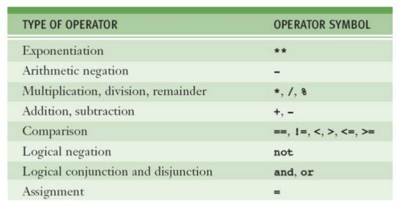
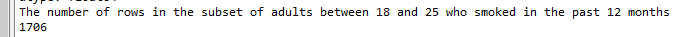
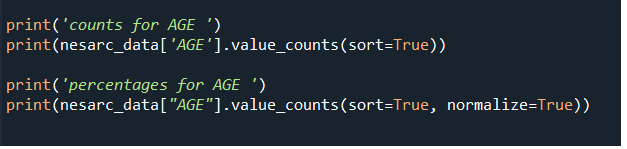
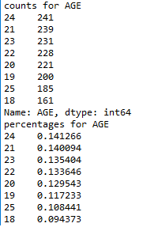
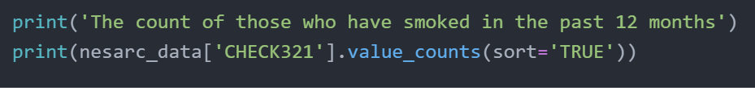

### 1. Row Selection

Once you examine frequency distributions for your variables you need to decide whether you want to look at a subset of the full dataset.

In lab 1 you have conducted frequency distributions on the entire data set and on the variables of interest which were TAB12MDX, CHECK321 and S3AQ3C1. The reesearch question concerning the association between smoking and nicotine dependence has been applied to the full dataset.

We now can decide to examine a subset of that dataset, we now only want to anlanyse those adults who are 25 or younger and exclude all adults older than the age of 25. We also decide we want to focus on recent smokers, rather than individuals who smoked more than a year ago.

The research question has not changed. Rather, the question will be asked based on only a subset of the observations that are available in a specific dataset that will help us answer our research question.

To implement these decisions we will create a new python file called Lab02.py still saving it in your working directory.


- Place the following code into that file and run it.

```py

import pandas
import numpy

#load dataset from the csv file in the dataframe called nesarc_data
nesarc_data = pandas.read_csv('nesarc_pds.csv',low_memory=False)

#convert all columns names to uppercase
nesarc_data.columns = map(str.upper, nesarc_data.columns)
#nesarc_data.columns = map(str.lower, nesarc_data.columns)

#set PANDAS to show all columns in Data frame
pandas.set_option('display.max_columns', None)

#convert all columns names to uppercase
nesarc_data.columns = map(str.upper, nesarc_data.columns)


#bug fix for display formats to avoid run time errors
pandas.set_option('display.float_format',lambda x:'%f'%x)

#display the size of the dataset as the number of rows and columns
print (len(nesarc_data)) 
print (len(nesarc_data.columns))

#display the data types in the dataset
print(nesarc_data.dtypes)

#display general information about the dataset
nesarc_data.info()

#output the first 5 rows of data
nesarc_data.head(5)

#convert spaces to NAN
nesarc_data['CHECK321']=nesarc_data['CHECK321'].replace(' ', numpy.nan)

#converting strings to numeric data for better output
nesarc_data['TAB12MDX'] = pandas.to_numeric(nesarc_data['TAB12MDX'], errors="coerce")
nesarc_data['CHECK321'] = pandas.to_numeric(nesarc_data['CHECK321'], errors="coerce")
nesarc_data['S3AQ3C1'] = pandas.to_numeric(nesarc_data['S3AQ3C1'], errors="coerce")

```
- Run the python file fully so that the datset loads and the necessary convesion of strings to numbes takes place. 
- Once you have done that, each new section of code that you add can be run by highlighting it and choosing Run Selection, or press F9.

- We will need to add logic statements that tell the program to include only those observations that will help you answer your research question.

- Logic statements require one or more operations. Here are common operators used in Python, you should be familiar with these from other programming languages.



- These include equal to, not equal to, less than, greater than, less than or equal to, and greater than or equal to.

- Our code needs to include three logic statements in order to include the specified observations (rows) from our dataset.

```py

age >= 18  and  age <=25 and smoker in last 12 months = yes

```

To do this we must place this logic in our Python code. First we must check in our code book to see what variable names we need to use for analysing age and recent smoker.

Page 5 in the code book shows us a variable called AGE that contains a number representing the age in years of each respondent. We will use a variable called CHECK321 which is the cigarette smoking status where the value 1 indicated the respondent smoked within the last 12 months.

You can see that is it very important to have a well documented code book to support your analysis.

- The code we need to add to our program is shown below:


```py
print('The number of rows in the subset of adults between 18 and 25 that have smoked in the past 12 months')
nesarc_data = nesarc_data[(nesarc_data['AGE']>=18) & (nesarc_data['AGE']<=25) & (nesarc_data['CHECK321']==1)]
print(len(nesarc_data))

```

- Run those lines of code.

- Remember we have to tell Python within each part of the logic statement what dataset we are working on and each variable name is held in quotation marks ' ' and square brackets [].

- Each logic statement is enclosed in parenthesis () and separated with in this case an 'and' symbol &. Finally the logic is contained with the square brackets.


- Save and run the whole program. You should at the end of the console the following output:



- Next write the code to generate distribution frequencies for the Age variable (as you did in lab1)


- Your code should look like this:



Your output like this:



Remember the output is only for the 1706 individuals between the ages of 18 and 25 who reported smoking in the past 12 months.

As a check to make sure you are working on the subset you can check the count for the variable CHECK321 and there should only be 1706 for the value 1.




## Tips

It is often useful to make a copy of a dataframe it is easily done using the following code:

```py
subset2=nesarc_data.copy()
```

It is then possible to use the new subset to do analysis but it can cause issues when dealing with datatypes that were converted however.
Sometimes if you want to do comparisons on a variable in the copy the data conversion we did in lab01 on the nesarc_data does not copy over to the subset. It just means you have to apply that conversion again to the new subset. (see the step 6 in lab 1 to remind yourself)

```py
print('Number of observations in subset 2')
print(len(subset2))
```
