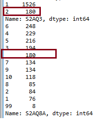
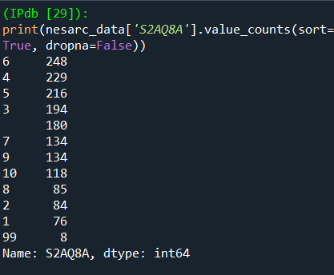

### 3. Data management continued

Next consider another variable, S3AQ3C1 which holds values for the usual smoking quantity.

Look up the codebook for this variable. It is a value of between 1 and 98. A value of 99 indicates an unknown response. It is this value that we want to deal with, we want to set it to missing since it doesn't measure the number of cigarettes smoked, but rather indicates that we have no information on cigarette use for individuals coded as 99.

Complete the same steps as you did for S3AQ3B1.

You should see 9 observations that contained values 99 that are now set to Nan.

Examine each variable that is of interest to you to manage any missing values.

The next step is deciding whether or not you need to code in valid data that has been unnecessarily set to missing.

In some data sets, particularly those based on surveys, there are often skip patterns. Skip patterns are often created in surveys that allow participants to skip questions in which the answer can be logically determined. In this way, missing data on some questions might mean that we can reasonably recover valid information.

For the question, Did you drink at least one alcoholic drink in the past 12 months? (variable S2AQ3), many participants said no. These individuals would not need to be asked the question about how often they drank alcohol in the past 12 months, therefore they are empty.

Look up the codebook for both of these variables so you are familiar.

First you should count the frequencies for each variable so you can see how many are blanks.



For this variable we need to find out first what the blank is, is it null, is it an empty string or it is a space.

An easy way to check is to do a count on the number of observations that fit a criteria:

Here we can see for S2AQ3 180 observations answered no to "did you drink at least one alcoholic drink in the past 12 months?" (value 2)



Then we can see that 180 observations also answered blank to S2AQ8A "How often they drank alcohol in the past 12 months?"

```py
#first see if there are any nulls
print('count of nulls')
print((nesarc_data['S2AQ8A'].isnull()).sum())

#next see if there are any empty values
print('count of empty')
print((nesarc_data['S2AQ8A']=="").sum())

#next see if there are any that contain a space
print('count of " " spaces')
print((nesarc_data['S2AQ8A']==" ").sum())

```

You should see 180 returned for the last line of code, this tells us there are 180 observations that contain a space.

We need to replace this " " with NaN. So for the variable (S2AQ8A), how often did you drink alcohol in the past 12 months, it would be reasonable to code this as valid data (with the value 11) rather than missing.

Now we want to replace the blank data with Nan.

```py
#replace the blank data with a NaN
nesarc_data['S2AQ8A']=nesarc_data['S2AQ8A'].replace(' ', numpy.NaN)

```
Now do the same count again for the full variable to see how many there are for each value:

```py
#Print the counts for the S2AQ8A variable and then sum the number of nulls
print('Counts for S2AQ8A')
print(nesarc_data['S2AQ8A'].value_counts(sort=True, dropna=False))

# or just count the nulls
print('counts of nulls')
print(nesarc_data['S2AQ8A'].isna().sum())

```

Next we want to replace the nulls with an actual value, in this case 11 (here we are adding a category to the list) We need to include if S2AQ3 is not equal to 9 to our logic statement, in order to separate the no responses

```py
#using loc to apply logic and replace with a new value of 11
nesarc_data.loc[(nesarc_data['S2AQ3']!=9) & (nesarc_data['S2AQ8A'].isnull()),'S2AQ8A']=11

```

print out the counts now for the complete variable to double check that you now have 180 observations for the value 11.
