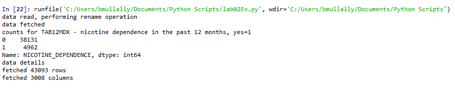

### 5. Exercises

Further Data Management

There are many ways to tidy up your dataframe.

- rename column names to readable names.
- remove any columns you are not using.
- print out a count the number of columns and rows.

#### Rename column names to readable names

Create a new python file, name it lab2Ex.py

Import pandas and numpy.

Just after the import statements we will list the columns that we want to use, to do this we create a dictionary to refer to when we rename and ultimately remove any other columns.

A dictionary are indexed by keys, which can be any immutable type. It is best to think of a dictionary as a set of key:value pairs, with the requirement that the keys are unique (within one dictionary). A pair of braces creates an empty dictionary {}.

Placing a comma-separated list of key:value pairs within the braces adds initial key:value pairs to the new dictionary as seen below:

```py
# SETUP
#Columns that will be read from the CSV file and give them names that make sense
nesarc_dict =  {
  'TAB12MDX': 'NICOTINE_DEPENDENCE',
  'CHECK321' : 'SMOKING_STATUS',
   'S3AQ3B1' : 'FREQUENCY_OF_SMOKING',
   'S3AQ3C1' : 'QUANTITY_SMOKED',
   'S2AQ3': 'DRANK_ALCOHOL',
   'S2AQ8A' : 'ALCOHOL_FREQUENCY'
}

```

Next we need to read in the data from the csv filter
```py
#LOAD DATA
nesarc_data = pandas.read_csv(
  'nesarc_pds.csv',
  low_memory=False
)
```


Now we can rename the columns using the dictionary to map the old name to the new name.

We use a pandas function rename with the columns option as seen below:


```py
# RENAME COLUMNS
print('data read, performing rename operation')
nesarc_data.rename(columns=nesarc_dict, inplace=True)
print('data fetched')

#TEST THE RENAMING
print('counts for TAB12MDX - nicotine dependence in the past 12 months, yes=1')
print(nesarc_data["NICOTINE_DEPENDENCE"].value_counts(sort=True))

```

You should now see the following if the renaming worked correctly:



Next we want to only keep in our nesarc dataframe the 6 columns we are working on in this lab.

```py
#Update the dataframe to only contain the columns you do want to use in your analysis.
nesarc_data = pandas.DataFrame(nesarc_data, columns = nesarc_dict.values())
print('new column amount: ' + str(len(nesarc_data.columns)))
```

This should show you an output of 6 for the number of columns.

Some useful properties and functions you can use on your dataframe:

```py
nesarc_data.head
nesarc_data.tail
nesarc_data.dtypes

```
