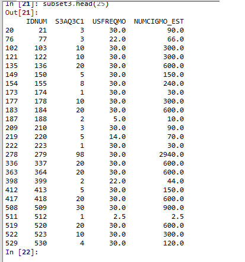

### 1. Creating Secondary Variables

#### Solution

The solution python files for lab02 are available here

- [lab2 python files](./archives/lab02.zip)

Save lab02.py to your working directory and run it to make sure it works. You can then make a copy and name the copy lab03.py and continue to work on the NESARC data.

#### Pandas Tutorials

If you are confused about the use of Pandas and in particular the DataFrame structure, take a look at the following site for help:

- <https://medium.com/dunder-data/pandas-tutorials/home>

The series data structure in Pandas is a 1-dimensional array to hold any datatype for example:

```py
pd.series(5, 6, 7, 4, 5)
```

We have used this when we created a dictionary for recoding in step 4 of lab 2.

```py
recode1= {1: 6, 2: 5, 3: 4, 4: 3, 5: 2, 6: 1}
```


The dataframe data structure in Pandas is a 2-dimensional array with columns of potentially different types. We think of it like a spreadsheet, rows and columns of data.

The lecture notes in topic Data Management 1 detail about pandas DataFrame.

#### Managing Data: Creating Secondary Variables

One of the later steps in data management is evaluating whether you might want to create secondary variables. They are usually variables that include information from two or more primary variables.

We can create secondary variables by using a mathematical or logical operation on two or more variables.

For our set of data we want to know the number of cigarettes smoked per month. We created a new variable USFREQMO in the last lab which tells us an estimate of the number of smoking days in a month for each respondent. If you look at the codebook the variable S3AQ3C1 holds values to answer the question of usual quantity per day.

We can simply multiple these two variables and the result represents the number of cigarettes per month smoked by respondents. We can call this new variable NUMCIGMO_EST


```py
nesarc_data['NUMCIGMO_EST'] = nesarc_data['USFREQMO'] * nesarc_data['S3AQ3C1']
```

Sometimes an error will occur to say you cannot do this operation due to datatypes being incompatible. You may need to make sure the variable S3AQ3C1 is in fact a number, you can add this piece of code to ensure this and then re-run the code above.

```py
nesarc_data['S3AQ3C1']=pandas.to_numeric(nesarc_data['S3AQ3C1'])
```
How can we check to make sure this new secondary variable was created as intended?

We will use a new statement that allows us to choose only those variables we wish to see together in the output.

```py
subset1=nesarc_data[['IDNUM','S3AQ3C1','USFREQMO', 'NUMCIGMO_EST','AGE']]
subset1.head(25)
```





You can do a quick scan to ensure the operation was correct by multiplying the third column of data with the fourth to produce the last column of data.

What you see in the above screenshot are the individual observations and the estimated number of cigarettes smoked in a month. This is a useful way to double check our work and make sure no errors have occurred.
