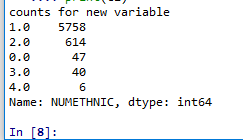

### 2. Combining more than two variables

What if we want to combine more than two variables?


For this task we are going to use the Adolescent Health data.

- [Add Health Data File](./archives/AddHealth.zip)

Download this zip and extract the .csv file, store in the same working directory as your python scripts and nesarc_pds.csv file. (setup in lab1)

Create a new file called lab3_step2.py and enter the following code:

```py
import pandas
import numpy

addhealth_data = pandas.read_csv('addhealth_pds.csv')
```

A good example of combining more than one variable is to create a secondary variable to characterise ethnicity from a number of separate primary variables in the Ad Health data. In this data set race or ethnicity are measured by a series of questions, coded 1 if yes and 0 if no.

Some respondents could've indicated more than one race or ethnicity, we could decide to characterise those adolescents who indicate multiple racial or ethical groups separately from those who could be characterised with a single ethnicity.

Open the codebook that was part of the zip file you downloaded. Open the pdf name INH01PUB.pdf and scroll to question 4. The variables we are interested in are named below and retail to Questions 4, and 6, the values with frequencies are listed in the code book.

- H1GI4
- H1GI6A
- H1GI6B
- H1GI6C
- H1GI6D


The new variable to create will be called NUMETHNIC, it will indicate the number of race or ethnicity variables that were endorsed. To do this we must sum the variables, so we must ensure they are of numerical data type.


```py
#convert all to number data type
addhealth_data['H1GI4'] = pandas.to_numeric(addhealth_data['H1GI4'])
addhealth_data['H1GI6A'] = pandas.to_numeric(addhealth_data['H1GI6A'])
addhealth_data['H1GI6B'] = pandas.to_numeric(addhealth_data['H1GI6B'])
addhealth_data['H1GI6C'] = pandas.to_numeric(addhealth_data['H1GI6C'])
addhealth_data['H1GI6D'] = pandas.to_numeric(addhealth_data['H1GI6D'])
```

Refer back to the code book and you will see that each of these variables has a potential value of 6 which means refused to answer, and 8 which means don't know. We will need to deal with this missing data so it is no included in our sum operation.

```py
#replace missing values for options 6 and 8
addhealth_data['H1GI4'] = addhealth_data['H1GI4'].replace([6,8], numpy.nan)
addhealth_data['H1GI6A'] = addhealth_data['H1GI6A'].replace([6,8], numpy.nan)
addhealth_data['H1GI6B'] = addhealth_data['H1GI6B'].replace([6,8], numpy.nan)
addhealth_data['H1GI6C'] = addhealth_data['H1GI6C'].replace([6,8], numpy.nan)
addhealth_data['H1GI6D'] = addhealth_data['H1GI6D'].replace([6,8], numpy.nan)

```


The following code will sum each of the variables and place the results into the new variable called NUMETHNIC

```py
#create the new variable NUETHNIC, holding the count of ethnicity's
addhealth_data['NUMETHNIC'] = 
addhealth_data['H1GI4'] + addhealth_data['H1GI6A'] + addhealth_data['H1GI6B'] + addhealth_data['H1GI6C'] + addhealth_data['H1GI6D']

```


Write the appropriate code to print out the following:


