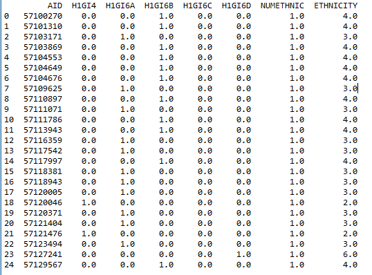

### 3. Functions to create a variable
Next we add statements that create a single secondary variable that characterizes each adolescents ethnicity.

We use the Define function shown here as def to create a new variable called ETHNICITY

Read the appropriate section in the code book to familiarise yourself with variables H1GI4, H1GI6A, H1GI6B, H1GI6C, and H1GI6D. These are used to code the new variable ETHNICITY.


```py
#This is how to define a function in python. The keyword def is used followed by the function name followed by parameters.
#A colon: signifies the end of the function header

def ETHNICITY (row):
    if row['NUMETHNIC']>1:
        return 1
    if row['H1GI4'] ==1:
        return 2
    if row['H1GI6A'] ==1:
        return 3
    if row['H1GI6B'] ==1:
        return 4
    if row['H1GI6C']==1:
        return 5
    if row['H1GI6D']==1:
        return 6

#next we apply the function along an axis of the dataframe, axis=1 means apply the function to each row
#in this case we use a lambda function call, the syntax is lambda X: X where lambda X: is the bound variable and the second X is the body of the function
#here the body is a call to a predefined function.
#we could of just used a regular call to the function which would of worked too.

addhealth_data['ETHNICITY'] = addhealth_data.apply(lambda row: ETHNICITY (row), axis=1)
```

The row code defines a temporary variable to be used in the function. Then we use the apply function to actually create the new variable in the dataset. Axis=1 tells Python to apply the function to each row.

Note that the lambda operator/function is a way to create small anonymous functions (functions without a name). These functions are throwaways (like callback or fat arrow functions in JavaScript or PHP) That is, they are just needed where they are created. Lambda functions are commonly used in combination with the functions filter(), map(), and reduce().

So if NUMETHNIC >1  the new variable ETHNICITY will return 1 indicating multiple racial or ethnic groups chosen.

All other codes then indicate a particular race for example:

- H1GI4 equals 1 then the ETHNICITY variable will return a value of 2 which means only Hispanic or Latino ethnicity was chosen.
- H1GI6A equals 1 then the ETHNICITY variable will return a value of 3 which means only Black or African-American ethnicity was chosen.
- H1GI6B equals 1 then the ETHNICITY variable will return a value of 4 which means only American Indian ethnicity was chosen.
- H1GI6C equals 1 then the ETHNICITY variable will return a value of 5 which means only Asian or Pacific Islander ethnicity was chosen.
- H1GI6D equals 1 then the ETHNICITY variable will return a value of 6 which means only White  was chosen.


Consider what you have learned so far and attempt to write the necessary code to only contain the necessary columns and then print out top 25 rows.



If you can not see all columns you can set the following option to expand the visible columns:

```py
pandas.set_option('display.max_columns',20);
``

This sets the maximum columns displayed to 20.
Save the Lab03-step2.py file and close it.
