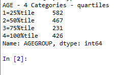
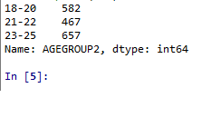
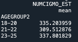
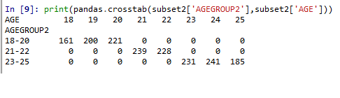

### 4. qcut() and cut()

Next you will work again on the NESARC dataset so open up the lab3.py file.

Once you have created secondary variables such as USFREQMO and NUMCIGMO_EST you can then consider whether any of your quantitative variables or categorical variables need to be further grouped or binned.

Currently AGE is a quantitative variable in the NESARC dataset, if we want to compare age groups categorically we need to group the values.

The first way we can group the values is by quartiles, remember these represent 25, 50, 75 and 100% of the dataset.

To do this we use the pandas.qcut() function passing as parameters the variable to be grouped, the number of quartiles and a list of variable names for each quartile.

We call the new variable AGEGROUP
```py
#Step 4 regroup values
#quartile split qcut function into 4 groups
print('AGE - 4 Categories - quartiles')
nesarc_data['AGEGROUP'] = pandas.qcut(nesarc_data.AGE, 4, labels=['1=25%tile','2=50%tile','3=75%tile','4=100%tile'])
print(nesarc_data['AGEGROUP'].value_counts(sort=False, dropna=True))

```




This means we can now use the groupby function and the aggregate function available in pandas suing this new variable. The below uses the AGEGROUP split to group the data, and then calculates the mean for the number of cigarettes smoked by that agegroup. It is worth looking up the documentation on these two functions.

- <https://pandas.pydata.org/docs/reference/api/pandas.DataFrame.agg.html>

- <https://pandas.pydata.org/docs/reference/api/pandas.DataFrame.groupby.html>

```py
#we can then groupby agegroup and see the mean for number of smoked
print('count values in categories using groupby')
print(nesarc_data.groupby(['AGEGROUP'], observed=False).agg({'NUMCIGMO_EST':['mean']}))

```


It is also an option to create custom splits using pandas cut function.

```py
#categorise variable based on customised splits using the cut() functions
# splits into three groups, 18-20, 21-22, and 23-25
nesarc_data['AGEGROUP2']= pandas.cut(nesarc_data.AGE, [17, 20, 22, 25], labels=['18-20','21-22','23-25'])
print(nesarc_data['AGEGROUP2'].value_counts(sort=False, dropna=True))

```



Try doing the groupby and aggregate using the AGEGROUP2 variable. You should get the following:




To compare the different groups of ages we can now run a crosstab on the agegroup2 variable


```py
#print out a crosstab of AGEGROUP and AGE
print('Crosstab showing the distribution of Age\'s for each AGEGROUP')
print(pandas.crosstab(nesarc_data['AGEGROUP2'],nesarc_data['AGE']))

```



## Exercise
Write a statement to output the value counts as percentages for the agegroup2 variable.
