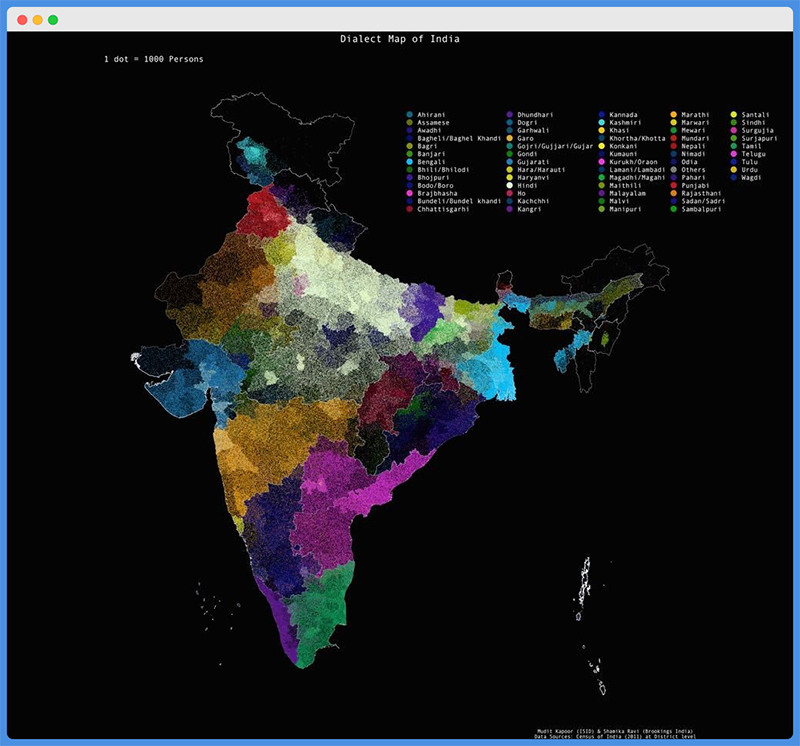
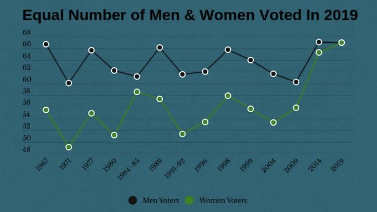
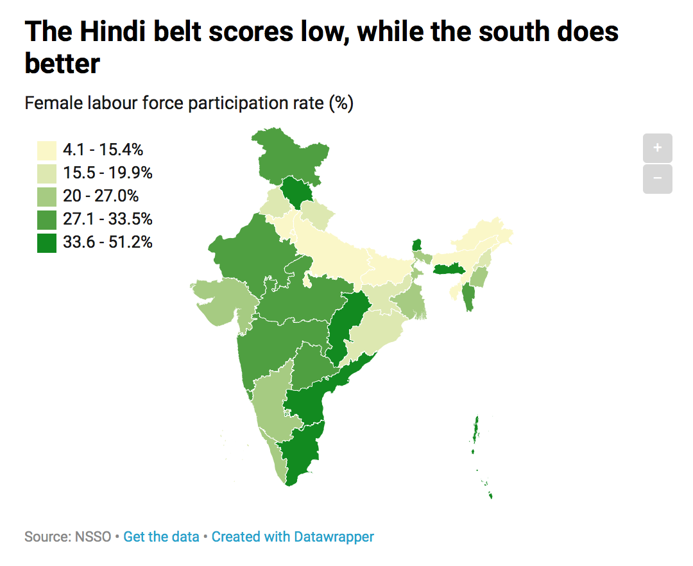
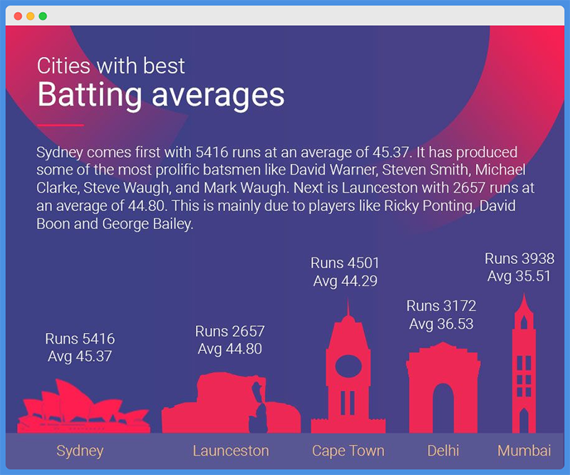
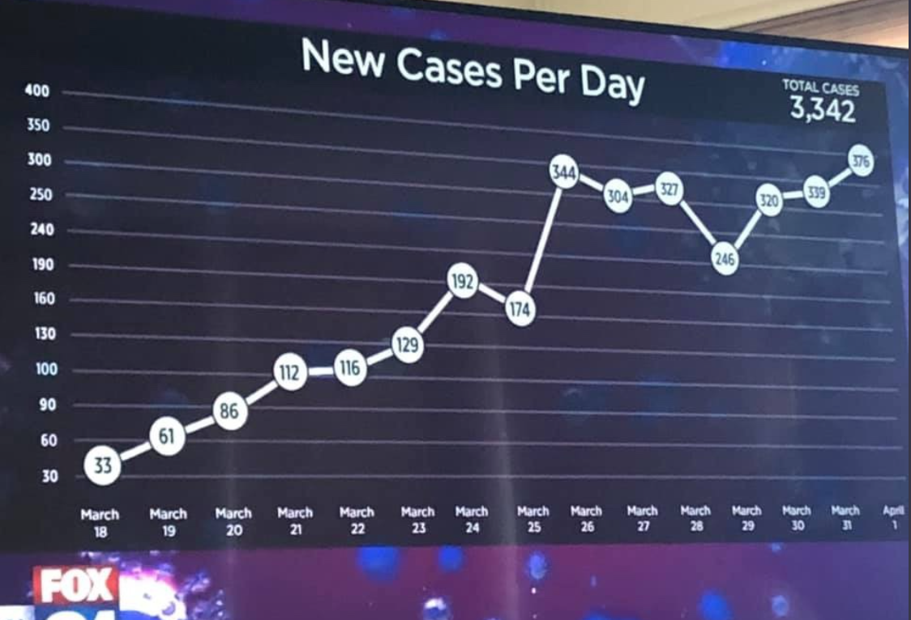

# Descriptive Statistics & Graphing

1. Conduct descriptive statistics on your variables of interest.
2. Begin creating univariate graphs on your categorical variables (bar charts).
3. Begin creating univariate graphs on your numerical variables (histogram).
4. Start to determine of your variables which are explanatory and which are response variables.
5. Document on your work so far for the summary report.

The following are reminders of how not to do a visualisation!

