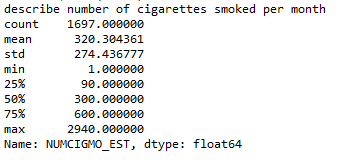

##  1. Descriptive Statistics


The first task is to create a new file called lab04.py, then write the code:

- to import pandas, and numpy as usual
- to load the nesarc dataset
- to create a subset that restricts down the dataset to those observations between 18 and 25 years old


Next...
- Create the NUMCIGMO\_EST as you did in last weeks lab (requires creating USFREQ, then USFREQMO, then NUMCIGMO\_EST).

- Copy the code from lab03 that recoded the smoking frequency ('S3AQ3B1') and place the new codes into 'USFREQMO' variable.

- Then replace any occurrence of 99 in the S3AQ3C1 variable with a NaN value.

- Create a new secondary variable called NUMCIGMO_EST by multiplying USFREQMO and S3AQ3C1 together.

- Create a new subset that just contains IDNUM, S3AQ3C1, USFREQMO, and NUMCIGMO_EST


## Exercise

- Write code to run frequency distributions for each of variables TAB12MDX and NUMCIGMO\_EST in the nesarc_data dataset, for both counts and percentages. You have done this previously using the value\_counts function.

- Next calculate the mean, median and standard deviation for both variables.




You can use describe() or write individual code commands for each statistical measure as shown below:

```py
#Description of NUMCIGMO_EST and mean, mode, median, std, min and max
print('describe number of cigarettes smoked per month')
print(nesarc_data['NUMCIGMO_EST'].describe())


print('mean')
print(nesarc_data['NUMCIGMO_EST'].mean())


print('std deviation')
print(nesarc_data['NUMCIGMO_EST'].std())


print('min')
print(nesarc_data['NUMCIGMO_EST'].min())


print('max')
print(nesarc_data['NUMCIGMO_EST'].max())


print('median')
print(nesarc_data['NUMCIGMO_EST'].median())


print('mode')
print(nesarc_data['NUMCIGMO_EST'].mode())
```
N.B. in the output from this code you should note that the count is 1,697 rather than the 1706. This is because Python does not include those cases with missing or NaN data in these calculations.
