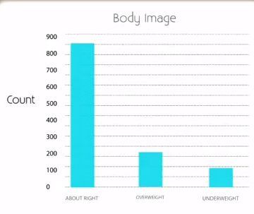
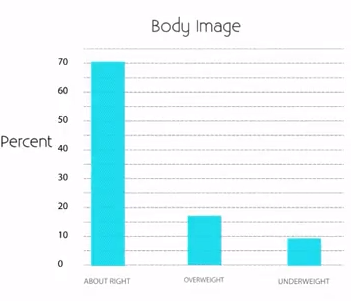
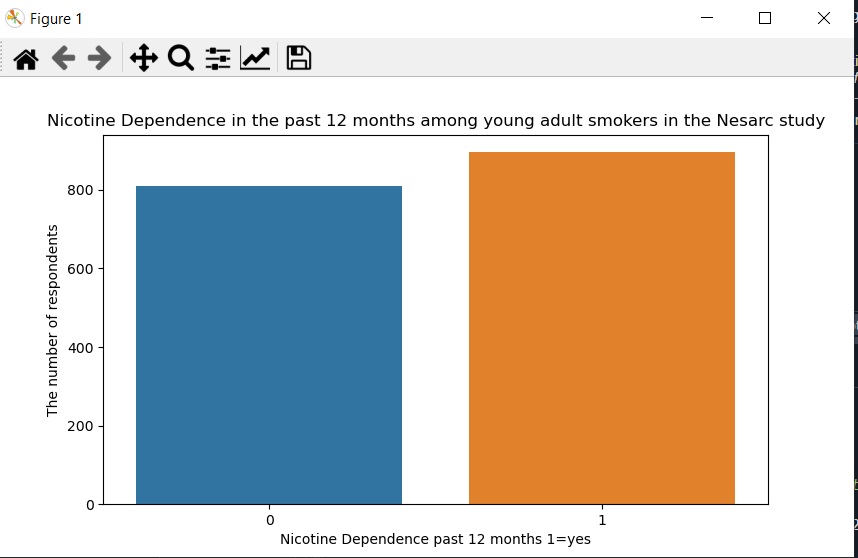

## 2. Univariate graphing

You will begin by graphing one variable at a time and then multiple variables within the graphs.

Bar charts are most commonly used to examine the distribution of individual variables.



This bar chart shows the distribution for the random sample of 1,200 college students who are asked, what is your perception of your body?

In this chart X or the horizontal axis includes the three values held in the variable: underweight, overweight, and about right.

The height of each bar is measured on the Y or vertical axis, as the number or count of college students giving each response.

This next bar chart shows the same data but as a percentage of the total sample.



The data we are going to visualise is from the NESARC data set. Variable TAB12MDX, representing diagnosis of nicotine dependence in the past 12 months. Along with the secondary variable you created in step 1 NUMCIGMO_EST, representing an estimate of the average number of cigarettes smoked per month.

###  Import Libraries
- To visualise in Python we need to import additional libraries into our program.
<a href="https://seaborn.pydata.org/" target="_ blank">Seaborn documentation</a>
<a href="https://matplotlib.org/stable/index.html" target="_ blank">Matplotlib documentation</a>

- Add the following import statements to the top of your python file.

```py
import seaborn
import matplotlib.pyplot as plt

```

Python code will generate the graphs that help us learn more about the data and to make decisions about next steps in our research.
The focus to start with is basic visualisations rather than polished, presentation ready graphs.

Categorical variables can be visualised one at a time using univariate graphs, also known as single variable bar charts.

### The basic code for a univariate graph of a categorical variable is as follows:

```py
#Categorical bar chart
seaborn.countplot(x='TAB12MDX',data=nesarc_data)
plt.xlabel('Nicotine Dependence past 12 months 1=yes')
plt.ylabel('The number of respondents')
plt.title('Nicotine Dependence in the past 12 months among young adult smokers in the Nesarc study')

```

- In the countplot function we name the categorical variable for the X axis as TAB12MDX and define the data frame as nesarc_data.
- Using the xlabel and ylabel functions we can put text on the X and Y axes. This is particularly important in your charts, the xlabel includes the 1=yes for this variable, without this the reader has to guess what the zero or 1 means.
- Using the title function we provide the bar chart with a clear title.

- Save and run this code.


- You will notice that charts may be produced "inline" in the iPython console window, or more likely as seen in the above image they will appear in the top right section of Spyder if you click on the tab that says plots.
- If they don't show there you can go to tools->preferences->ipython console-> Graphics and set the Graphics backend to Automatic. Then restart the kernel by pressing Ctrl + . when in the console.
- When you run your code again the graph will show in a separate window something like this:



- There seems to be an issue though with multiple graphs that each one overlays the previous.
- So for your CA I would therefore run each seaborn chart separately.
- You may need to drag the width and/or height of your window to make it bigger and easier to see the title and labels.
- For your continuous assessment you will be taking a screenshot of the graph or clicking the save button and saving it as a png to insert into your report.

- This bar chart shows the number of young adult smokers with nicotine dependence to be 896 , as indicated by a response code of 1, and the number of young adult smokers without nicotine dependence to be 810, indicated by a 0.

## Exercise:

What do you think happens if you use the describe() function on the categorical variable TAB12MDX?
- Try it and see what the output is.
- Now convert the TAB12MDX numerical variable into a categorical variable

```py
nesarc_data['TAB12MDX'] = nesarc_data['TAB12MDX'].astype('category')
```

- Run the describe code again to see what it outputs this time.
