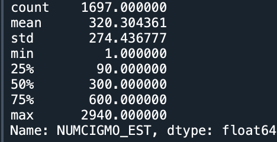
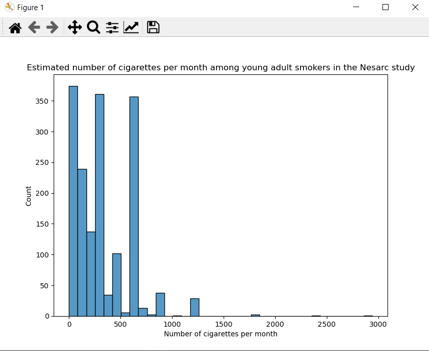
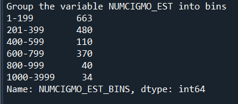
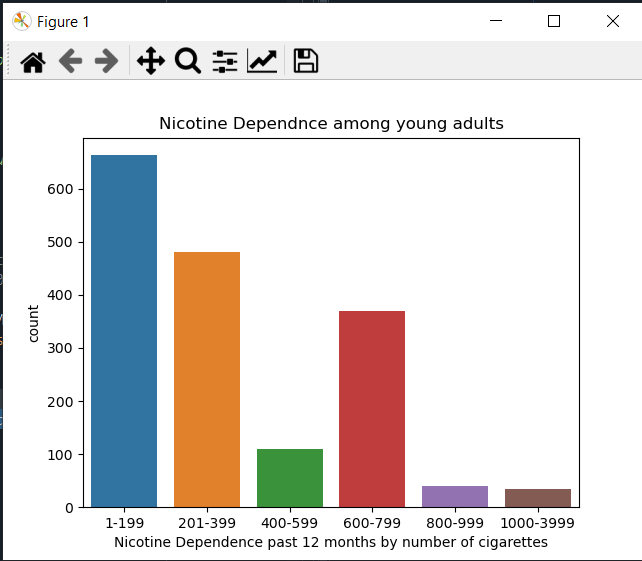

## 3. Univariate Histogram for quantitative variable:

When we plot a quantitative variable using bars it is called a histogram.


- First describe the numerical variable in the same way as you did for TAB12MDX. It should show this ouput.



- You will now create a histogram for the quantitative variable NUMCIGMO_EST, it holds the estimated number of cigarettes smoked per month.
- The histogram plot function or histplot is used.
- We name the quantitative variable NUMCIGMO_EST which automatically is placed on the X axis.

```py
#numerical histogram
seaborn.histplot(nesarc_data.NUMCIGMO_EST.dropna())
plt.xlabel('Number of cigarettes per month')
plt.title('Estimated number of cigarettes per month among young adult smokers in the Nesarc study')

```
- include this code and run it to produce the histogram that should look like this:



- The histogram shows that most of the respondents smoke as estimated number of less than 500 hundred a month with a few outliers over 1000.

##  Exercises:

To investigate further it would be interesting to see the quantitative variable converted to a categorical one that is broken into groups, for example we could group them as 1-200 cigarettes, 201-400 etc.

- Write the code necessary to group the NUMCIGMO_EST variable into the bins shown below and count the frequency within each bin. Remember you did this in Lab3 step 4 using cut() and qcut()



Next plot the new categorical variable  on a bar chart as below:


