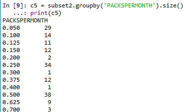
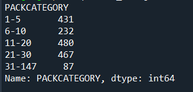
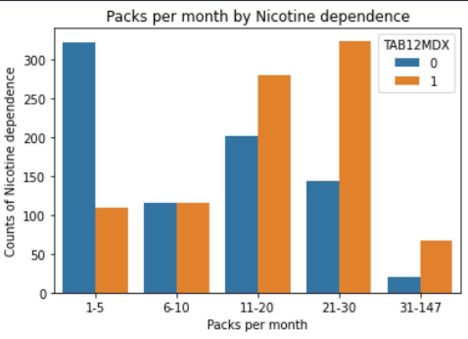
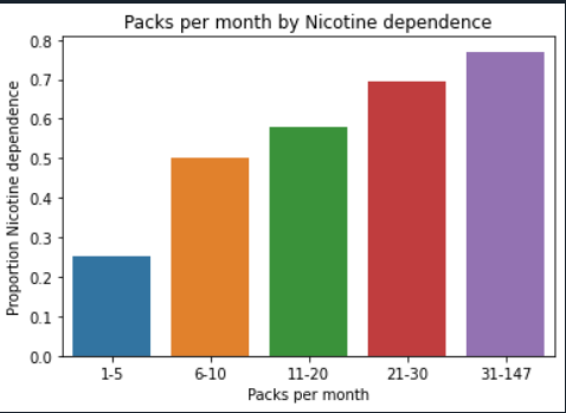

### 4. Bivariate Graphing - Categorical to Categorical Bar chart

Each variable when ploting bivariate graphs has a role to play.
- A response variable is also known as the dependent or outcome variable.
- An explanatory variable is also known as the independent or the predictor variable.

#### Our research question is:

- Does the number of cigarettes smoked per month determine Nicotine Dependence?

- The first question to ask is what type is the response variable?

- Is it Categorical or Numerical?

In this case the response or dependent variable is Nicotine Dependence which is categorical.

Next we need to determine how many categories are in this response variable.

Nicotine Dependence is coded 1 for yes, 0 for no, we have two categories.


- The next question is what type is the explanatory variable?

The explanatory variable is the number of cigarettes smoked per month (NUMCIGMO_EST), this is a quantitative variable.

Placing a quantitative explanatory variable on the X axis does not work where our response variable is categorical (Y axis). We would prefer to have categorical on the X axis so we can create a categorical to numerical chart. (see lecture notes on visualisation options)

Therefore we must bin our explanatory variable into groups in order to visualise the relationship we are interested in. This requires some data management that will allow us to construct a categorical to categorical bar chart.

Having viewed the full output for NUMCIGMO_EST we can use the cut function to group individuals in various ways. For example into quartiles or into custom groups.

In this case it makes sense to group based on quantities. Cigarette packs contain 20 cigarettes each. We can create a new variable that estimates the number of packs that each individual smokes per month, rather than the number of cigarettes.

The new variable is called PACKSPERMONTH and is equal to the variable NUMCIGMO_EST  divided by 20.

```py
#create a new variable packspermonth
nesarc_data['PACKSPERMONTH'] = nesarc_data['NUMCIGMO_EST'] / 20
# count the number of smokers in each packspermonth
print('describe packs per month')
print(nesarc_data.groupby('PACKSPERMONTH').size())

```




Packs per month is still a quantitative variable, but now we can more easily create groups based on number of packs smoked in a month.

After examining the frequency distribution, we will create groups that include those who've smoked 1-5 packs per month, 6-10, 11-20, 21-30 and 30+ packs per month.

```py
#create a variable to hold a packspermonth category
nesarc_data['PACKCATEGORY'] = pandas.cut(nesarc_data.PACKSPERMONTH, [0,5,10,20,30,147], labels=['1-5','6-10','11-20','21-30','31-147'])

#change format of variable from numerical to categorical
nesarc_data['PACKCATEGORY'] = nesarc_data['PACKCATEGORY'].astype('category')

#output the counts for the groups
print('describe pack category')
print(nesarc_data['PACKCATEGORY'].groupby(nesarc_data['PACKCATEGORY']).size())


```



Now we can make a categorical to categorical bar chart, our explanatory variable TAB12MDX is Categorical
with two values 0 and 1, our response variable is categorical with 5 values.

```py
#bivariate category to category bar chart
seaborn.countplot(x='PACKCATEGORY',hue='TAB12MDX',data=nesarc_data)
plt.xlabel('Packs per month')
plt.ylabel('Counts of Nicotine dependence')
plt.title('Packs per month by Nicotine dependence')

```



The output shows the count within each pack category that are nicotine dependent and the count that are not nicotine dependent.
We can see for pack category 6-10 exactly 50% are nicotine dependent and 50% are not. 

We can visualise this slightly differently if we convert TAB12MDX into a numeric variable because it holds only 0 or 1.

```py
#convert TAB12MDX to a numerical variable 
nesarc_data['TAB12MDX'] = pandas.to_numeric(nesarc_data['TAB12MDX'],errors='coerce')
```

Then create the following barplot.

```py
seaborn.catplot(x='PACKCATEGORY',y='TAB12MDX',data=nesarc_data, kind='bar',errorbar=None)
plt.xlabel('Packs per month')
plt.ylabel('Proportion Nicotine dependence')
plt.title('Packs per month by Nicotine dependence')
```




Take a look at this chart and see if you understand the Nicotine Dependence variable.

In this case we know the response variable (TAB12MDX) is categorical, the catplot function by default calculates the mean where the response variable (Y axis) is numeric. this means it shows the proportion of individuals with nicotine dependence. This is because our variable stores either 1 or 0 so if all the 1's are added up and divided by the count then it gives the proportion. We know that Python will not calculate a mean if a variable is set to category. 


If we interpret the chart we can see that those individuals who smoke 1-5 packs a month only 25% of them are nicotine dependent, whereas 75% of smokers who smoke between 31 and 147 packs per month say they are nicotine dependent. It is clear from the bar chart that the greater the number of packs smoked per month the higher the percentage of individuals that are classed as nicotine dependent.


- A relationship may exist between smoking and nicotine dependence as hypothesized.

N.B if our explanatory variable (PACKSPERMONTH) was already categorical we could of skipped the step to cut() and created the barplot.

If the response variable had more than two categories what would we need to do? We would need to collapse it into two categories. This is done in the next step.
