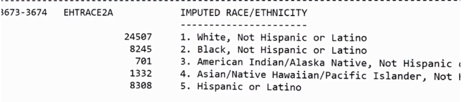
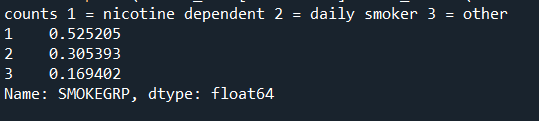
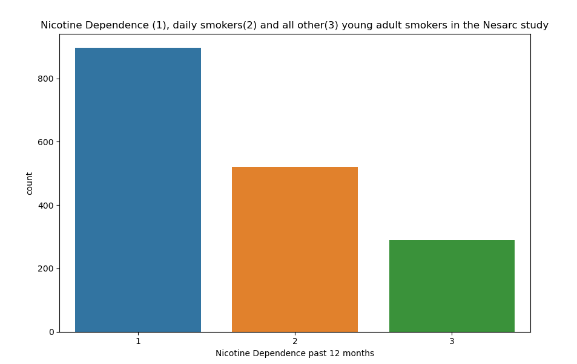
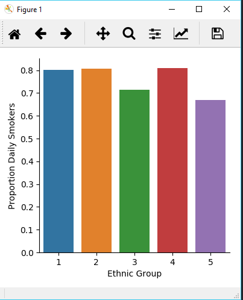
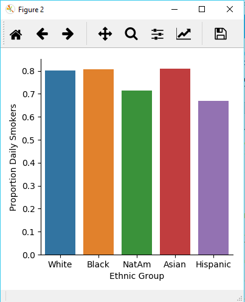
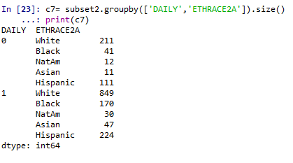
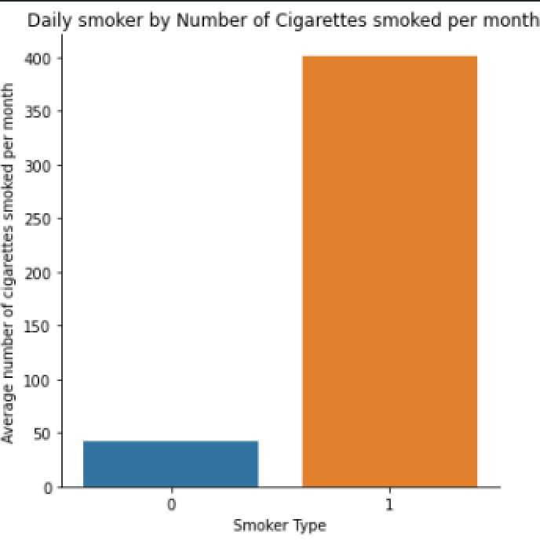

## 5. Bivariate graph: Categorical to Categorical bar chart where the response variable contains more than 2 categories.

If we modify our research question to look at the association between ethnicity and smoking stage.

We will create a response variable that categorises young adult smokers into three groups, Non-daily smokers, Daily smokers, and those with Nicotine Dependence.

In the code book the variable ETHRACE2A shows the categories of race and frequencies for each category.



- To create the new variable called SMOKEGRP we will enter the following code:

```py
#define a function called SMOKEGRP, it takes a row as its parameters
#if  that row has a 1 for TAB12MDX then the the function returns a 1
#if  that row has a 30 for USFREQMO then the the function returns a 2
#otherwise it returns a 3.
def SMOKEGRP (row):
  if row['TAB12MDX'] == 1:
    return 1
  elif row['USFREQMO'] == 30:
    return 2
  else:
    return 3
#create the new variable SMOKEGRP by applying the function to each row in the nesarc_data
nesarc_data['SMOKEGRP'] = nesarc_data.apply(lambda row: SMOKEGRP (row), axis=1)

```
The SMOKEGRP variable will hold 1 if the individual is nicotine dependent, 2 if they are a daily smoker and 3 for all other young adult smokers.

It is important to consider what categories you need to define and in what order to define them.

Lets see the percentage for each category:

```py
#counts for each smoke group
print('counts 1 = nicotine dependent 2 = daily smoker 3 = other')
print(nesarc_data['SMOKEGRP'].value_counts(normalize=True))

```



- Now write the code to create a univariate bar chart for this new variable.



### Use this variable in a bivariate graph with the ethnicity variable

Now to investigate this variable with another we need to collapse it into two categories.
Two perfectly reasonable options are:

1. Examine the association between ethnicity and daily versus non-daily smokers.

Or

2. Examine the association between ethnicity and nicotine dependent versus non-nicotine dependent individuals.

In either case, data management has to occur first.

- To collapse the variable into daily and non-daily smokers we use the following:

```py
#define a function to return 1 if the row has 30 for USFREQMO and 0 if it has any other number.
def DAILY (row):
  if row['USFREQMO'] == 30:
    return 1
  elif row['USFREQMO'] != 30:
    return 0
#apply the function to each row in the nesarc dataset
    nesarc_data['DAILY'] = nesarc_data.apply(lambda row: DAILY(row), axis=1)
#counts for daily(1) smokers and others(0)
    print(nesarc_data.groupby('DAILY').size())

```

This shows us that 1320 young adult are daily smokers and 386 are not daily smokers.

Now we can graph the relationship between our categorical explanatory variable ETHRACE2A and this new response categorical variable DAILY.

Remember our categorical response variable cannot have more than two categories or levels. Those categories should be coded as zero or one. Zero representing negative and one representing yes or positive. In this format the mean calculated for the y axis gives us the proportion of the positive observations.

- First lets make sure that ETHRACE2A is the correct data type and see the counts for the variable too.

```py
nesarc_data['ETHRACE2A'] = nesarc_data['ETHRACE2A'].astype('category')

#show the counts for each ethnic category 1 through 5
print(nesarc_data.groupby('ETHRACE2A').size())
```


```py
#graph the relationship between categorical ETHRACE2A and new categorical DAILY
seaborn.catplot(x='ETHRACE2A', y='DAILY', data=nesarc_data, kind='bar', ci=None)
plt.xlabel('Ethnic Group')
plt.ylabel('Proportion Daily Smokers')
plt.title('Proportion of Daily Smokers for each Ethnic group')

```





Notice that the categories (1,2,3,4,5) may not ordered on the X axis, and because they are not labelled it is harder to interpret the bar chart.

We can rename categorical variable values for graphing by giving the variable ETHRACE2A new value labels using cat.rename_categories()


```py
#rename the categories in ETHRACE2A so they are more meaningfull
nesarc_data['ETHRACE2A'] = nesarc_data['ETHRACE2A'].cat.rename_categories(['White','Black','NatAm','Asian','Hispanic'])

```




We can see that the proportion (count of all the 1's in DAILY) of daily smokers for Native American's and Hispanic's is somewhat lower than other Ethnic races.

By running the following statement you can see the actual counts for daily and non daily smokers per ethnic group:

```py
#output the counts for ethnic groups for daily and non daily smokers.
print(nesarc_data.groupby(['DAILY','ETHRACE2A']).size())

```



# Categorical to Numerical chart

- Our question might be what is the relationship between number of cigarettes smoked in a month and smoker status (daily vs non-daily smokers)
- In this case our response variable is DAILY with two categories 0 and 1,  and our explanatory variable is NUMCIGMO_EST 
- We create a catplot that shows the average number of cigarettes smoked by a daily smoker and by a non-daily smoker. (numeric variable is placed on the y axis always in a catplot())
- We output the mean for NUMCIGMO_EST to double check the values.

```py
#categorical response variable, numeric explanatory variable
seaborn.catplot(x='DAILY',y='NUMCIGMO_EST',data=nesarc_data, errorbar=None, kind='bar')
plt.xlabel('Smoker Type')
plt.ylabel('Average number of cigarettes smoked per month')
plt.title(' Daily smoker by Number of Cigarettes smoked per month')

#output the average number of cigarettes for daily and non-daily smokers
print(nesarc_data.groupby(['DAILY']).agg({'NUMCIGMO_EST':'mean'}))
```

