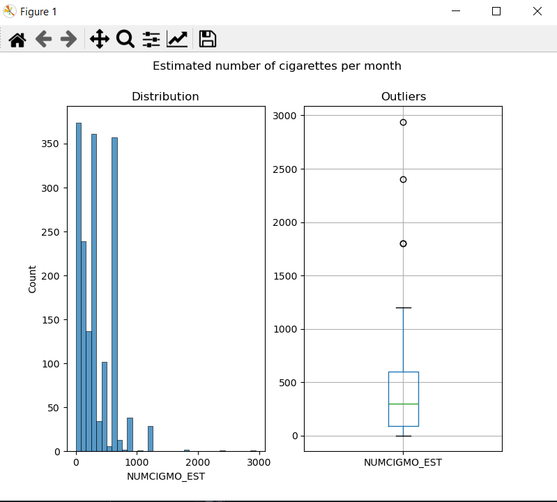

## 5. Multiple graph output

A library worth investigating more is <a href="https://seaborn.pydata.org/" target="_ blank">Seaborn </a> below is an example of how to create a figure that contains two charts, a histogram and a boxplot. Both are created for the number of cigarettes smoked per month variable.


```py
#this creates a figure that holds two charts, a histogram and a box plot

#matplotlib library allows us to create a subplot which in this case is 1 row and 2 coloumns
#it returns a figure and an ax or axes, in this cases the axes is a single dimension array
#with two positions, ax[0] and ax[1] each for a chart.
fig, ax = plt.subplots(1,2)

#we can set the main title using fig.suptitle
fig.suptitle('Number of Cigarettes per month estimate')
#set the title of the chart in position 0
ax[0].title.set_text('Distribution')

#create the histogram of NUMCIGMO_EST data for ax[0]
seaborn.histplot(nesarc_data['NUMCIGMO_EST'].dropna(),kde=False, ax=ax[0])
#name the title for the 
plt.title('Estimated number of cigarettes per month')

#set the title for the second chart in ax[1]
ax[1].title.set_text('Outliers')
#create the boxplot for ax[1]
nesarc_data.boxplot(column='NUMCIGMO_EST', ax=ax[1])
plt.show

```


