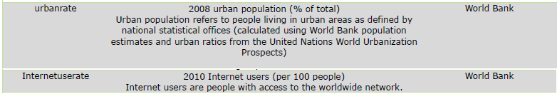
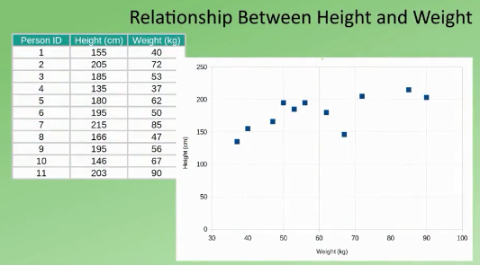

### 1. Numerical Response variables

In the previous lab you created visualisations where the response variable was categorical, in one example the explanatory variable was numerical (Number of cigarettes smoked per month) and one where the explanatory variable was categorical (Ethnicity).

For this example we will look at the scenario where the response variable is numeric.

### Gapminder dataset

We are interested in the association between the percentage of the population living in urban setting within each country, and in the country's rates of internet use, that is the percentage of people with access to the world wide web.

Here are the details from the codebook for the variables we are interested in.

For this research question both the response and explanatory variables are quantitative.

A bar chart would not work in this situation, the graph of choice is the scatterplot.

A scatterplot by definition is a graph of plotted points that show the relationship between two quantitative variables.

In a scatterplot, data for each observation's explanatory and response variables are plotted.

This scatterplot shows a sample of 11 observations according to the relationship between height and weight.

Since we are dealing with a new data set the Gapminder data set, we will start a new python program.

Include your import statements as before.

Save the gapminder.csv file to your Spyder working directory.

- [Gapminder file](./archives/gapminder.zip)

#### Exercises

Write the statement necessary to read in the gapminder.csv File

Next we need to make sure that both variables are seen as numeric by Python. Look back on previous labs to find the correct syntax for using the to_numeric() function in the Pandas library.

If the conversion is not working it may be because there are spaces or blanks in some observations for one or both of these variables.

You may have to use .replace() function to find any ' ' and replace with numpy.NaN again check back on previous lab files.

Once you have the conversions complete you can then describe each variable.

Write the statements to describe each variable and print the output so you can see the count, mean, standard deviation etc for each variable.
