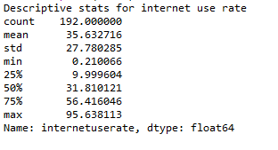
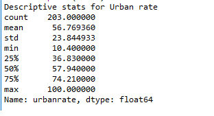
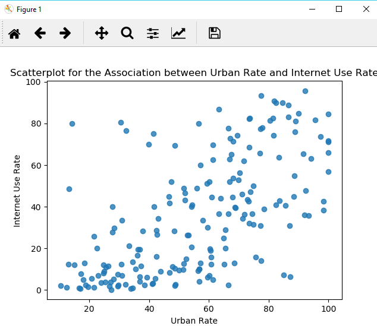
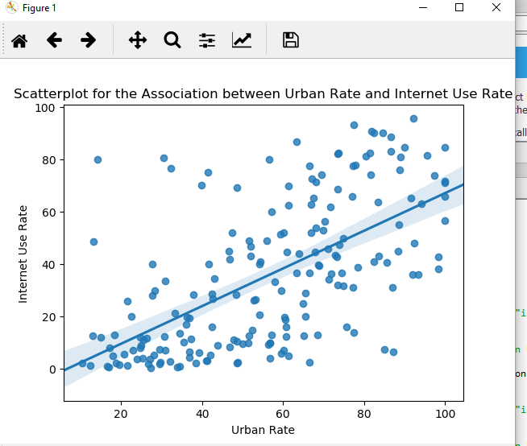
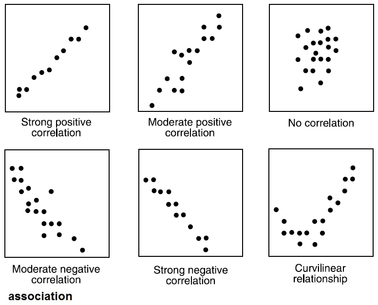

### 2. Quantitative to Quantitative chart: Scatter plot

You should see the following descriptive stats for each variable:






We can see for urban rate, the mean percent of the population living in Urban settings is about 57%, the standard deviation is about 24%, suggesting that there is quite a bit of variability from country to country in terms of the population living in urban settings.

Is there a relationship between the two variables?

We can explore this question using a scatterplot.

Python provides the capability to produce a scatterplot using the seaborn library. Remember to include the import statements for seaborn and matplotlib.

~~~ py

#basic scatterplot

seaborn.regplot(x="urbanrate", y="internetuserate", fit_reg=False, data=gapminder_data)
plt.xlabel('Urban Rate')
plt.ylabel('Internet Use Rate')
plt.title('Scatterplot for the Association between Urban Rate and Internet Use Rate')


~~~

The explanatory variable is urban rate so it goes on the X axis, the response variable Internet Use Rate goes on the Y axis. For this example we ask python to suppress the line of best fit. Again we use the xlabel, ylabel and title functions.



Here we can see what looks like a positive relationship between urban rate and internet use rate. Change the code slightly so that the best fit line is displayed.




We can also run a correlation on these variables to see what the pearson correlation value is.

```py
y = gapminder_data['internetuserate']
x = gapminder_data['urbanrate']

x.corr(y)
```
 The output is .61 which indicates that a relationship does exist.

#### Exercises

Try plotting a scatter chart now for the explanatory variable incomeperperson with the response variable internetuserate.
What relationship does this chart present? Is it stronger or weaker than the previous relationship?

How closely do the dots follow the linear pattern?

What is the pearson correlation for this data?

These examples show the different types of relationships presented by a scatter plot.



Not all relationships can be classified as positive or negative. Also if you can't put a line through the dots, if the dots are just a cloud of specks on a graph, then there may be no relationship.
