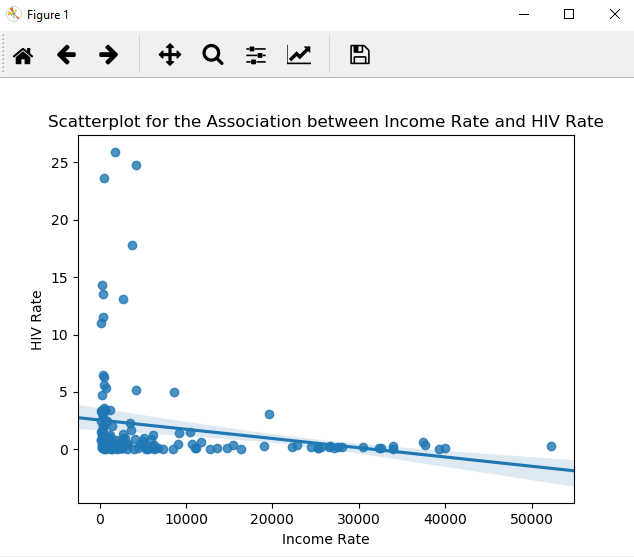
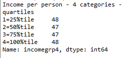
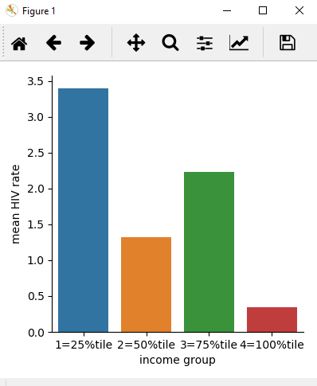

### 3. Categorical to Quantitative bar chart.

Create the scatter plot for response variable "hivrate" and explanatory variable "incomeperperson"

Remember to make sure both variables are numeric.

Here the dots seem to clump in the lower part of the graph. In this case it is hard to determine the relationship here.

To get a better sense of whether or not there is a relationship between these two variables, we could try and convert the incomeperperson explanatory variable into a categorical variable.

To do this we have to do some data management.

- use the qcut function to split the incomeperperson variable into four equal parts, call the new variable incomegrp4.
- display the frequency counts for the new variable and print them to the console.

Now you can see the distribution of the incomegrp4 variable. The four ordered groups we created, showing that there are 48 in the lowest income group, 47 in the next 25%, 47 in the next 25% and 48 in the top 25%.

With this new categorical explanatory variable, you can now create the last type of bivariate graph, that is the categorical to quantitative bar chart.

The code to use is identical to that used for the categorical to categorical graph but what will be plotted on the y-axis is the mean HIV rate.

~~~py
#bivariate bar graph C->Q
seaborn.catplot(x='incomegrp4',y='hivrate',data=gapminder_data,kind='bar',errorbar=None)
plt.xlabel('income group')
plt.ylabel('mean HIV rate')
~~~

In this bar chart we can see the differences in HIV rate based on the countries income per person groups.
