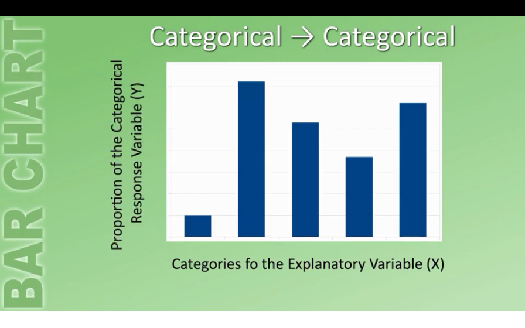
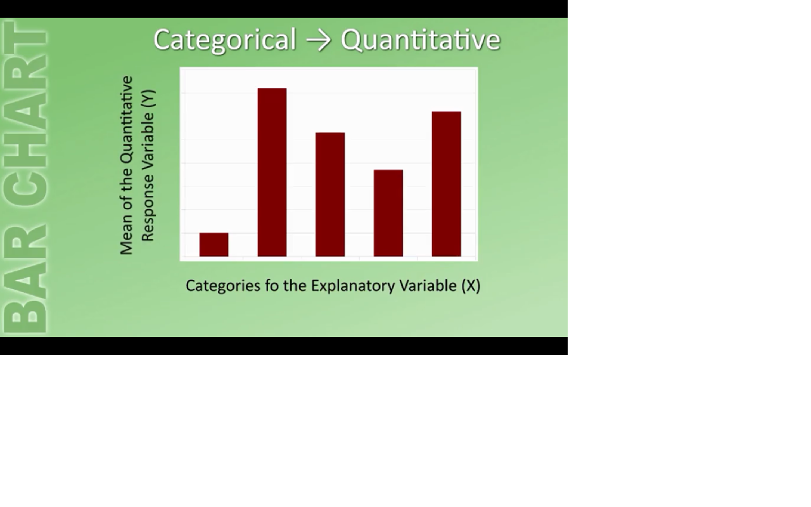
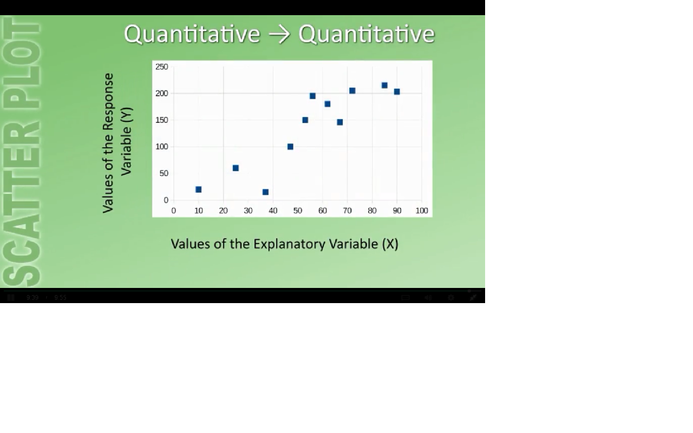

### 4. Bivarate chart options

#### Categorical to categorical graph

Explanatory variable on the X axis (categorical), the proportion of our response variable on the Y axis (2 group categorical). We use the catplot for this type of visualisation. We can also create a countplot for two categorical variables by using hue="y variable name"

#### Categorical to Quantitative graph

Explanatory variable on the X axis (Categorical), Mean of the response variable (quantitative) on the Y axis. We again use a catplot for this type of visualisation.

#### Quantitative to Quantitative graphs

Explanatory variable values on the X axis (quantitative), response variable values on the Y axis (quantitative). We use a scatter plot for this type of visualisation.

