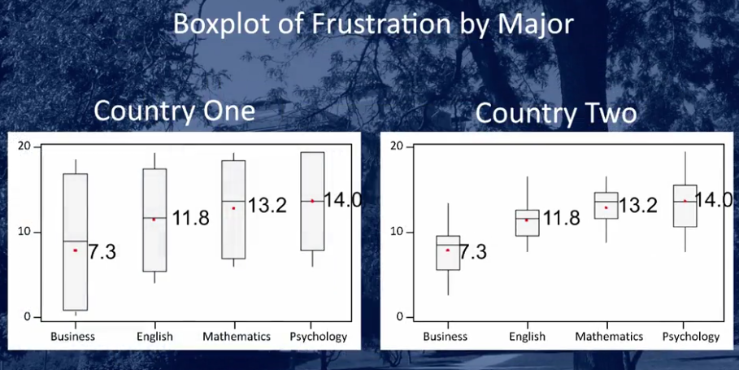
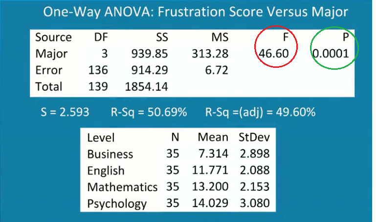

### 1. Choosing a statistical test

- Statistical hypothesis testing is defined as assessing evidence provided by the raw data in favour of or against each hypothesis about the population.
- Propability is fundamental to inferential statistics.
- Hypothesis testing is used when we want to make decisions concerning populations on the basis of having only sample data.
- The specific statistical test that you use to evaluate your hypothesis, will depend on the type of explanatory and response variables that you have chosen.

### Bivariate Statistical Tools:

If you have a categorical explanatory variable, and a quantitative response variable, you use:
- ANOVA- analysis of variance

If you have a categorical explanatory variable, and a categorical response variable, you use:
- X2 Chi-Square test of independence

If you have quantitative explanatory and response variables, you use:
- r Correlation coefficient

If you have quantitative explanatory variable, and a categorical response variable you would recode the explanatory variable into two categories and then use the X2 Chi-Square test of independence.


### A new relationship to hypothesise: Is academic frustration related to major?

It is believed that students with different majors may experience different levels of academic frustration. Random samples of 35 individuals, each of Business, English, Mathematics and Psychology majors were asked to rate their level of academic frustration, on a scales of one, the lowest, to twenty, the highest.


- Our explanatory variable X is the categorical variable Major type.
- Our response variable Y is the numeric variable academic frustration.

We will be examining the mean academic frustration for each major, if they are all the same then this tells us there is no difference in the level of academic frustration for each major.

- Null hypothesis claims that there is no relationship between major and academic frustration.
- Alternate hypothesis claims that a relationship does exist.


### F-Statistic

```
F = Variation among sample means / variation within groups
```
In this context, we look at the variation between the mean academic frustration for majors, divided by the variation within each majors


This measures to what extent the difference between the majors dominates over the usual variation within a major.
If the variation is large within a major, the differences between majors become negligible and there would be little evidence against the null hypothesis.
If the variation is small within a major, the differences between majors become significant and there would be evidence to reject the null hypothesis.



This image shows a box plot for two populations, country one and country two.
- This demonstrates the importance of understanding the data, so you are not only comparing means, you must look at the variability, so spread and shape also.
- Both countries show exactly the same means for each major.
- Country one has greater variability in the sample data for each major.
- Country two has far less variability in the sample data for each major.

When we apply one-way Anova for country two testing the relationship between major and frustration score.
The F statistic circled in red is 46.60. We know this is the variability among means divided by the variability within groups, this large number suggests the variability among means is much greater than that within the sample groups.



The P value of the ANOVA F Test is the probability of getting an F statistic as large as we got or even larger had the null hypothesis been true. In other words it tells us how surprising it is to find data like those observed. The p value is almost zero, telling us it would be next to impossible to get data like those observed had the mean frustration level of the four majors been the same. The P value tells us that we would incorrectly reject the null hypothesis one in ten thousand times (also known as a type 1 error). We will be correct in rejecting the null hypothesis 9999 times out of 10,000.

So we can confidently reject the null hypothesis, frustration level means of the four majors are not all the same.

Next you will test a hypothesis presented in the lecture.
