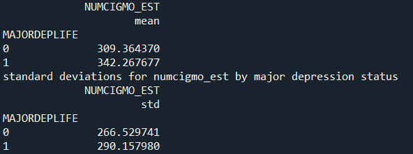
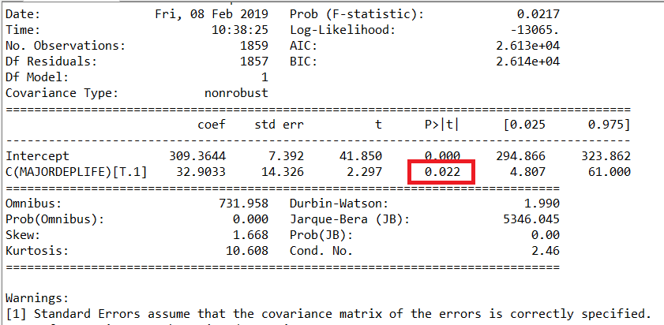

### 2. Hypothesis testing - Categorical Explanatory variable and a Quantitative Response variable.

We are going to carry out hypothesis testing on the NESARC data.

- We want to evaluate if there is an association between a diagnosis of major depression and how much a person smokes.

#### Step 1 : Stating the hypotheses

- *Null hypothesis:* There is no difference in smoking quantity between people with and without depression.
- *Alternate hypothesis:* There is a difference in smoking quantity between people with and without depression.

- The explanatory variable here is the existence of major depression (MAJORDEPLIFE), it is a categorical variable with two values, yes or no (1,0)
- The response variable here is the number of cigarettes smoked (NUMCIGMO_EST), it is a numerical variable ranging from 1 to 2940.

#### Step 2 : Choose Sample

We are going to test the hypotheses among individuals who are smokers and those that are between 18 and 26. The sample size should be 1706.

Create a new lab06.py file in spyder, reuse the necessary code from previous labs so that you:

- import the necessary libraries numpy and pandas
- load the data from csv file
- replace any ' ' spaces with Nan for CHECK321, S3AQ3B1 and S3AQ3C1.
- convert CHECK321, S3AQ3B1 and S3AQ3C1 to numeric  variables
- limit the rows to those smokers between the ages of 18 and 26.
- set missing numerical data to NaN (any 9 or 99 for variables S3AQ3B1 and S3AQ3C1)
- create a dictionary for recoding that maps the number of days in the month so that those that answered 1 for daily smoker (S3AQ3B1) now show 30, those that choose 2 now show 22 and so on (as you did in lab3).
- Create a secondary variable called NUMCIGMO_EST by multiplying USFREQMO and S3AQ3C1.
- Print out the groupby of NUMCIGMO_EST so that you can see how many people smoked for each value in the variable.

#### P-Value Statistical Significance

The reason for using an inferential test is to get a probability value (p-value). The p-value provides an estimate of how often we would get the obtained result by chance if in fact the null hypothesis is true.

In statistics a result is called statistically significant if it is unlikely to have occurred by chance alone.
- the most commonly used standard or cut off is 0.05 or 5%.
- this standard if called the significance level of a test and usually shown by the Greek letter alpha, alpha is said to be equal to 0.05.
- if the p-value is small, less than 0.05, this suggests that it is more than 95% likely that the association of interest would be present following repeated samples drawn from the population.
- this also means the data would be rare or surprising (only happen less than 5% of the time) when the null hypothesis is true.
- the data therefore provides significant evidence against the null hypothesis so we reject the null hypothesis and accept the alternate hypothesis.
- If the p-value is greater than alpha (0.05) then the data is not considered surprising enough when the null hypothesis is true. Therefore it does not provide enough evidence to reject the null hypothesis.


Your code should look something like this:

```py
import numpy
import pandas
import statsmodels.stats.multicomp as multi
import seaborn
import matplotlib.pyplot as plt


pandas.set_option('display.float_format',lambda x: '%f'%x)

nesarc_data = pandas.read_csv('nesarc_pds.csv', low_memory=False)


var_in_use = [
    'CHECK321',
    'S3AQ3B1',
    'S3AQ3C1',
    'AGE']

for i in var_in_use:
    nesarc_data[i] = nesarc_data[i].replace(" ", numpy.nan)
    nesarc_data[i] = pandas.to_numeric(nesarc_data[i])
    print('Descriptive stats for ' + i)
    print(nesarc_data[i].describe())

nesarc_data = nesarc_data[(nesarc_data['AGE']>=18) & (nesarc_data['AGE']<=26) & (nesarc_data['CHECK321']==1)]


#SETTING MISSING NUMERICAL DATA
nesarc_data['S3AQ3B1']=nesarc_data['S3AQ3B1'].replace(9, numpy.nan)
nesarc_data['S3AQ3C1']=nesarc_data['S3AQ3C1'].replace(99, numpy.nan)

#recoding number of days smoked in the past month
recode1 = {1: 30, 2: 22, 3: 14, 4: 5, 5: 2.5, 6: 1}
nesarc_data['USFREQMO']= nesarc_data['S3AQ3B1'].map(recode1)

#test that the maping took place
print(nesarc_data[['S3AQ3B1','USFREQMO']])


# Create a secondary variable multiplying the days smoked/month and the number of cig/per day
nesarc_data['NUMCIGMO_EST']=nesarc_data['USFREQMO'] * nesarc_data['S3AQ3C1']

#print the number of people per value.
print('print the number of people per value in NUMCIGMO_EST')
print(nesarc_data.groupby('NUMCIGMO_EST').size())


```

Now we want to calculate the p-value for our sample of 1859 observations, using NUMCIGMO_EST and MAJORDEPLIFE variables.
First add the following import statement:

```py
import statsmodels.formula.api as smf

```

Next add the following :

```py

#calculate the means and standard deviations for monthly smoking for each category of MAJORDEPLIFE
#remember we did something similar in lab3 step 4
print('means and Std deviation for numcigmo_est by major depression status')

#Mean for NUMCIGMO_EST by each value in MAJORDEPLIFE
print('means for NUMCIGMO_EST by Major lIfe depression yes=1')
print(nesarc_data.groupby(['MAJORDEPLIFE']).agg({'NUMCIGMO_EST':['mean']}))

print('standard deviations for numcigmo_est by major depression status')
print(nesarc_data.groupby(['MAJORDEPLIFE']).agg({'NUMCIGMO_EST':['std']}))

# using OLS function for calculating the F-statistic and associated p value

model1 = smf.ols(formula='NUMCIGMO_EST ~ C(MAJORDEPLIFE)', data=nesarc_data)
results1 = model1.fit()
print(results1.summary())

```

OLS is a powerful modelling approach that we use in a multivariate context. For this section of the course we use it for ANOVA, later we will use it for regression analysis.
The parameters given to smf.ols are the quantitative variable NUMCIGMO_EST and the categorical explanatory variable MAJORDEPLIFE, we indicate to python that it is categorical by including the capital C, we then also include the dataframe that is to be used for the model.

#### Step 2: Assess Evidence



We can see that with this sample we find that young adults (18-26) with depression smoked an average of 342.3 cigarettes per month with a standard deviation of 290 cigarettes.

Young adults without depression smoked an average of 309.4 cigarettes per month with a standard deviation of 266 cigarettes.

So the difference between quantity of cigarettes smoked by young adults in the past year with and without depression is 33.3 per month, a pack and a half.

Looking at the output for the p-value



We can see the p-value is 0.022, which is obviously less that 0.05. this means that the probability that we would get a difference of this size when the null hypothesis is true is 2%. So in this case we can reject the null hypothesis, and say that young adults (18-26) smokers with depression smoke significantly more cigarettes per month than those without depression.

A different way of saying this is that if we reject the null hypothesis and say there is a difference between the average smoked by those with and without depression , we would be wrong 2 out of 100 times. we would be correct 98% of the time, this is a level of certainty that gives us confidence in saying that there is a significant association between smoking and depression among current young adult smokers.
