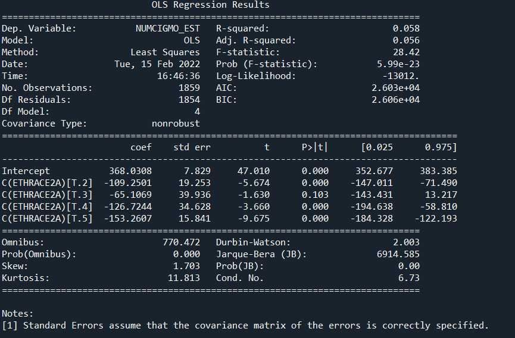
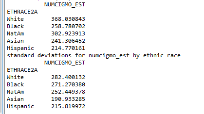
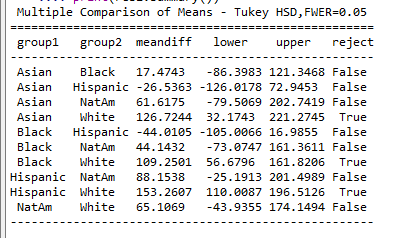

### 3. Categorical Explanatory variable with more than two values

If the categorical explanatory variable has more than two groups then we run and interpret the results slightly differently. We will look at the relationship between ethnicity and smoking quantity.

- What is the null hypothesis?
- What is the alternate hypothesis?

- Null hypothesis is that no relationship exists between ethnicity and the amount of cigarettes smoked.
- Alternate hypothesis is that there is relationship and the number of cigarettes is different depending on ethenicity.

The response variable is numberical, number of cigarettes smoked.

The explanatory variable is categorical with more than two values, it has five:
- 1 is white,
- 2 is black,
- 3 is American Indian/Alaskan native,
- 4 is Asian native/Hawaiian pacific islander,
- 5 is Hispanic or latino.

So by running an analysis of variance, we're asking whether the number of cigarettes smoked differs for different ethnic groups.

Make a call to dropna() for the variables NUMCIGMO_EST and ETHRACE2A so both only include observations with valid data.

Make a similar call to ols but change the explanatory variable to ETHRACE2A.

Save and run the program.



We can see the F statistic is 28.42 The Prob(F-statistic) value is written by Python in scientific notation, we know to move the decimal point to the left 23 times, or in other words add a decimal point and 23 zeros to the front of 5.99, resulting in a very small p value = 0.00000000000000000000000599. We look at the f statistic first because there are multiple categories.

This tells us we can safely reject the null hypothesis and say that there is an association between ethnicity and number of cigarettes smoked.

This is the additional code needed to run the analysis:

```py
#Step 3
#Explanatory variable with more than two values
#ethnicity & smoking - graph delveloped in lab 4 step 4

#only valid data allowed in the two variables
nesarc_data['NUMCIGMO_EST'] = nesarc_data['NUMCIGMO_EST'].dropna()
nesarc_data['ETHRACE2A'] = nesarc_data['ETHRACE2A'].dropna()

model2 = smf.ols(formula='NUMCIGMO_EST ~ C(ETHRACE2A)', data=nesarc_data)
results2 = model2.fit()
print(results2.summary())

```


We should also look at the means and standard deviations for each group to see how different they are (remember the discussion on major and academic frustration in step 1). We will also recode the ethnic groups from 1-5 to White, Black, NatAm, Asian and Hispanic to make it easier to understand the output.

```py

#Recode variable type and categories instead of 1 to 5
nesarc_data['ETHRACE2A'] = nesarc_data['ETHRACE2A'].astype('category')

nesarc_data['ETHRACE2A'] = nesarc_data['ETHRACE2A'].cat.rename_categories(['White','Black','NatAm','Asian','Hispanic'])

#calculate the means and standard deviations for monthly smoking for each category of MAJORDEPLIFE
#Mean for NUMCIGMO_EST by each value in ETHRACE2A
print('means and std deviations for numcigmo_est by Ethnic race')
print(nesarc_data.groupby(['ETHRACE2A']).agg({'NUMCIGMO_EST':['mean']}))

#Std deviation for NUMCIGMO_EST by each value in MAJORDEPLIFE
print('standard deviations for numcigmo_est by Ethnicity')
print(nesarc_data.groupby(['ETHRACE2A']).agg({'NUMCIGMO_EST':['std']}))

```

You should see the following mean and standard deviations :



Average number of cigarettes smoked for White group is 368 with a standard deviation of 282, average number of cigarettes smoked for Hispanic group is 215 with a standard deviation of 215.
The F statistic and the p value do not provide enough insight into why the null hypothesis can be rejected.

Looking at the output can you tell which groups are significantly different?
For example, the ethnic group with the lowest mean number of cigarettes smoked per month among young adult smokers is ethnic group five, Hispanic or Latino. The group with the highest number of cigarettes smoked per month is ethnic group one, white.

The difficulty of using only the F-statistic and p value where the explanatory variable has more than two values is that they cannot explain in what way the means are not equal. There may only be two groups means that are not equal. It does not tell us which groups are significant.

To determine this we must perform a post hoc test. It conducts paired comparisons. We do this to protect against type 1 errors (rejecting the null hypothesis incorrectly). There are many different post hoc tests you can conduct, more important is to conduct one than to choose a particular type.

We will use the Tukey HSDT, or Honestly Significant Difference Test.

To do this we must import a library:

```py
from statsmodels.stats.multicomp import MultiComparison
```
When the paired values of NUMCIGMO_EST and ETHRACE2A are compared sometimes there is an issue if other variables are the in dataframe passed to the multicomparison model. So we will filter the nesarc_data into a new dataframe that just contains those two variables.

```py
#filter nesarc data into a new dataframe object that only contains the paired variables we want to compare
tukey_data = nesarc_data.filter(items=['NUMCIGMO_EST', 'ETHRACE2A']).dropna()
```

Next add the following code:

```py
#Step 3 post hoc test

mc1 = MultiComparison(tukey_data['NUMCIGMO_EST'], tukey_data['ETHRACE2A'])
res1 = mc1.tukeyhsd()
print(res1.summary())
```

The quantitative response variable NUMCIGMO_EST is included in the call to MultiComparison() and the categorical variable ETHRACE2A.
A summary table of the comparisons are presented.



In the fourth row of the table, we see the comparison between White and Asian ethnic groups, it shows the mean differences between these two groups. In the last column we can determine which ethnic groups smoke significantly different mean number of cigarettes than the others by identifying the comparisons in which we can reject the null hypothesis, that is, in which reject equals true.

So we can see that White ethnic group  is significantly different than Asian, Black and Hispanic.
Looking again at the mean values, we can say that those indicating White ethnicity smoke significantly more cigarettes per month than individuals indicating Black, Asian and Hispanic ethnicity.
