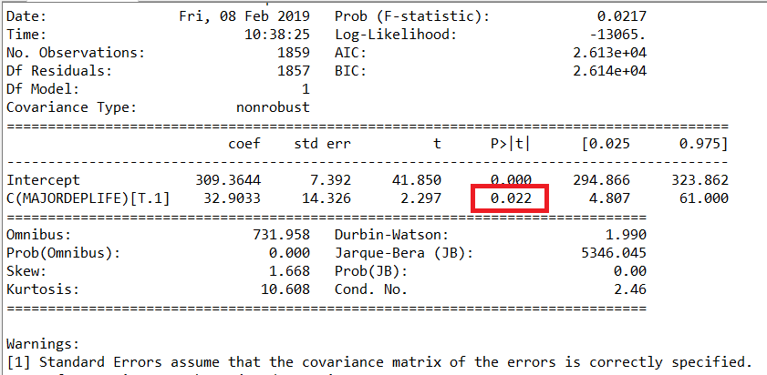

### Introduction to Regression

In lab06 you worked on hypothesis testing, this is the initial work conducted to determine relationships between variables.
Also in lab06 you worked on the association between a diagnosis of major depression and how much a person smokes and you worked on the associated between a diagnosis of major depression and ethnicity.

#### From Lab06
- Explanatory variable `MAJORDEPLIFE` is a categorical variable.
- Response variable `NUMCIGMO_EST` is a numerical variable.

Looking back at the output for lab06 step 2 we can see the following:

#### Regression helps us to predict a numeric value.
The output from the OLS hypothesis testing can also be informative and help to predict a value.
We can now use the intercept value and the coef value to determine how many cigarettes would be smoked by someone with a diagnosis of major depression.

*The linear equation is used to do this.*
Remeber the Y value is always the response variable, and the X value the explanatory variable.
In this case our slope is the coefficient value for the explanatory variable i.e. 32.9033.
The intercept is the coefficient value for the row of data named intercept.

The output from ANOVA can be used for the intercept, and slope in the equation:
~~~
y = mx + b

y = slope(x) + intercept

NUMCIGMO_EST = 32.9033 (MAJORDEPLIFE) + 309.3644

~~~

This tells us that when MAJORDEPLIFE contains the value of 1 indicating major depression, then the number of cigarettes smoked  will be:

~~~

NUMCIGMO_EST = 32.9033(1) + 309.3644
NUMCIGMO_EST = 342

~~~

When MAJORDEPLIFE contains the value of 0 indicating no diagnosis of major depression, then the number of cigarettes smoked will be:

~~~

NUMCIGMO_EST = 32.9033(0) + 309.3644
NUMCIGMO_EST = 309

~~~
