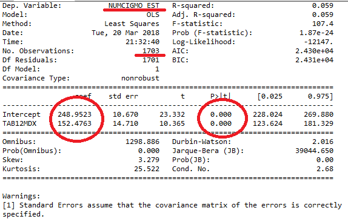

### Linear regression

For this lab we will predict the number of cigarettes smoked  if someone is diagnosed as nicotine dependent.

Lets look at the linear relationship between nicotine dependence and the number of cigarettes smoked. Nicotine Dependence is a binary categorical explanatory variable, and the number of cigarettes smoked per month is a quantitative response variable. We will use Anova again to determine the relationship.

*Our research question is:*

- Is having nicotine dependence (explanatory/categorical) associated with an increased number of cigarettes smoked (response/numerical)?


*Our hypotheses are:*

- The null hypothesis is nicotine dependence has no relationship with the number of cigarettes smoked.
- The alternate hypothesis is nicotine dependence has a relationship with the number of cigarettes smoked.


Open the following python file and save as Lab07_regression.py

- [lab7 starter python file](./archives/lab7_starter.zip)

At the end of this file we will add some code now to build a regression model.

Take note, in the code we must ensure that the variables `NUMCIGMO_EST` and `TAB12MDX` have no spaces " " and are in fact numerical.


Next enter the following:
~~~

print('OLS regression model for the association between nicotine dependence and number of cigarettes smoked per month')
reg1 = smf.ols('NUMCIGMO_EST ~ TAB12MDX',data=nesarc_data).fit()
print(reg1.summary())

~~~


The response variable always goes before the ~ tilda.




The name of our response variable, the number of observations with valid values in both variables.
The parameter estimates (for the line equation) and our p values are also highlighted in the image above.

~~~
y = mx + b

y = slope(x) + intercept

NUMCIGMO_EST = 152.47 (TAB12MDX) + 248.95

~~~


What does this tell us?

the variable TAB12MDX contains the value 1 if the observation is nicotine dependent and the value zero if the observation is not nicotine dependent.

We can place these values into the equation to get the number of cigarettes smoked for each group.

~~~

NUMCIGMO_EST = 152.47(0) + 248.95
NUMCIGMO_EST = 248.95

NUMCIGMO_EST = 152.47(1) + 248.95
NUMCIGMO_EST = 401.42

~~~

Overall the model shows an F-Statistic value of 107.4 with a very small Prob (F stat) value ( that is less than our alpha value of .5 which tells us with 95% confidence that the null hypothesis is rejected) showing that the nicotine dependence does have a relationship with the number of cigarettes smoked per month and it is statistically significant.


The R-Squared value however shows that the nicotine dependence variable only accounts for 5% of the variance in the number of cigarettes smoked.


The intercept is 248.95 and is statistically significant with a p value of <.01.

Smokers without nicotine dependence smoke approximately 249 cigarettes per month.

Smokers with nicotine dependence smoke approximately 401 cigarettes per month.

We can support this finding with investigating the mean number of cigarettes per month for each group.

```py
#mean and standard deviation for number of cigarettes for TAB12MDX values (yes =1, no=0)
print("Mean  number of cigarettes for nicotine dependence and not nicotine dependent")
print(nesarc_data.groupby(['TAB12MDX']).agg({'NUMCIGMO_EST':['mean']}))

print('Std dev of  number of cigarettes for nicotine dependence and not nicotine dependent')
print(nesarc_data.groupby(['TAB12MDX']).agg({'NUMCIGMO_EST':['std']}))

```

When you see the output from this piece of code the mean for observations that are not nicotine dependent (zero value in TAB12MDX) is the same as the calculated regression equation 248.95. The same applied when TAB12MDX holds a 1 value for nicotine dependence.

Remember when you calculate the mean using the groupby on a categorical variable like TAB12MDX there are only two values so it shows you the mean for 0 that is not nicotine dependent and 1 for nicotine dependent.
If you want to get the mean for a numerical variable you use the following :
~~~

dataframe_name['variable_name'].mean()

~~~
