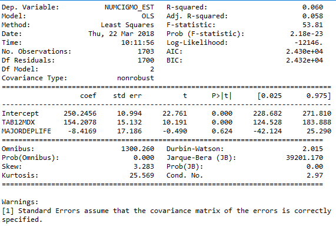
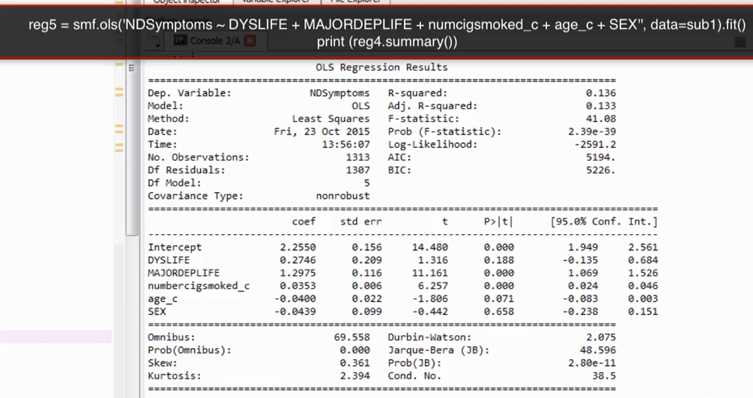

### Multivariant Regression

We now have evidence that nicotine dependence is associated to the number of cigarettes smoked per month, we also know that having major depression is also associated to the number of cigarettes smoked.

We can add the categorical explanatory variable `MAJORDEPLIFE`, it has two values, 0 when the observation does not have major depression and 1 when the observation does.

Perhaps major depression is a confounder variable (another variable that impacts a relationship) and is the true reason the number of cigarettes increases.


```py

#Multivariate linear regression
print('OLS regression model for the association between nicotine dependence, major depression and number of cigarettes smoked per month')
reg2 = smf.ols('NUMCIGMO_EST ~ TAB12MDX + MAJORDEPLIFE',data=nesarc_data).fit()
print(reg2.summary())

```



Looking at the results we can see that adding the MAJORDEPLIFE variable has increased the overall prob (F statistic) value. The MAJORDEPLIFE variable also shows a p value that is > 0.05 and so is not statistically significant and the coefficient value is negative. This means we cannot reject the null hypothesis that regression model is not significant for both variables effects on number of cigarettes.

However we can see that the nicotine dependence is still statistically significantly associated with number of cigarettes smoked having controlled for the existence of Major depression. We can conclude that Major depression is not a confounding variable in this case.

If the p value for nicotine dependence changed and was no longer < 0.05 it would mean that major depression was a confounding variable and was responsible for the association.

_Note:_ if a parameter estimate (coefficient) is negative and has a significant P value, then it means the variable has a negative association with the response variable. These are called parameter estimates because they are from our sample they are not from the complete population.

For multiple regression we can keep adding categorical explanatory variables to check for confounding variables.

For example the following shows the output from testing the association of age, gender, number of cigarettes, major depression and Dysthymia on the quantitative response variable: number of nicotine dependent symptoms.



In this output we can see that only Major depression and number of cigarettes smoked have a statistically significant association with the number of nicotine dependent symptoms.

# Centering Explanatory Variables
Where a quantitative explanatory variable is included in the model, it is necessary to centre the data. Centred data has a mean of zero. For this example the age variable and the number of cigarettes are quantitative. Therefore each observation's age has the mean age subtracted from it and the number of cigarettes smoked for each observation has the mean number of cigarettes smoked subtracted from it, in order to include them in the model.

```py
#centering explanatory variables
nesarc_data['numcigsmoked_c'] = (nesarc_data['NUMCIGMO_EST'] - nesarc_data['NUMCIGMO_EST'].mean())
nesarc_data['age_c'] = (nesarc_data['AGE'] - nesarc_data['AGE'].mean())
```


It is important to remember even after controlling many additional explanatory variables in our model we can not prove causation.
