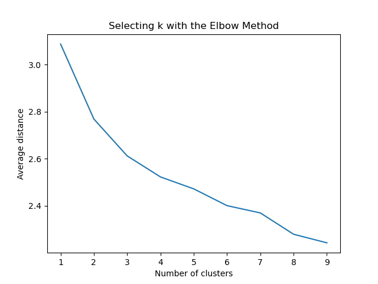

### Cluster analysis

Create a new file called Lab08_clustering.py

To run a K-means cluster analysis in Python, first we call in the libraries we need.

In addition to pandas, numpy and matplotlib libraries we'll need the train_test_split function from the sklearn.cross_validation library, and the prerocessing function from the sklearn library.
Finally we need the k-Means function from sklearn.cluster library.

```py


from pandas import Series, DataFrame
import pandas as pd
import numpy as np
import matplotlib.pylab as plt
from sklearn.model_selection import train_test_split
from sklearn import preprocessing
from sklearn.cluster import KMeans
import os
```
We also need to set an environment variable on your laptops to make sure the running of KMeans doesn't run out of memory. 

- You can do this by creating a new environment varible in the setting of your laptop, or by including the following line of code in your python file:

```py
os.environ["OMP_NUM_THREADS"] = '1'
 ```

Save the following csv file to your working directory

- [add health csv file](./archives/lab08_addhealth.csv)

We will load this file into our dataframe and conduct some basic data management.

``` py
"""
Data Management
"""
addhealth_data = pd.read_csv("lab08_addhealth.csv")

#set PANDAS to show all columns in Data frame
pd.set_option('display.max_columns', None)

#upper-case all DataFrame column names
addhealth_data.columns = map(str.upper, addhealth_data.columns)
addhealth_data.columns

# Data Management

var_in_use = [
    'ALCEVR1',
    'ALCPROBS1',
    'MAREVER1',
    'DEP1',
    'ESTEEM1',
    'VIOL1',
    'DEVIANT1',
    'FAMCONCT',
    'SCHCONN1',
    'PARACTV',
    'PARPRES'
    ]

var_validation = "GPA1"

 # Convert to numeric and coerce non-numeric values to NaN
for i in var_in_use + [var_validation]:
    addhealth_data[i] = addhealth_data[i].replace(" ", np.nan)
    addhealth_data[i] = pd.to_numeric(addhealth_data[i], errors='coerce')
    print('Descriptive stats for' +i)
    print(addhealth_data[i].describe())

 

# Drop rows that have missing values in any of the cluster variables or the validation variable
addhealth_data = addhealth_data.dropna(subset=var_in_use + [var_validation])


# subset clustering variables
cluster=addhealth_data[var_in_use].copy()
cluster.describe()

```


This dataset contains data on adolescent health in the U.S. it includes data on alcohol problems, violence, self esteem, academics, family and many other aspects.

The code above imports the required libraries and once the data is loaded it converts all column names to uppercase, replace any spaces with NaN and convert to numbers and then clean out all observations that have missing data on any variables using the dropna function. We then create a data set called cluster which contains the variables to be used for clustering.

In cluster analysis, variables with large values contribute more to the distance calculations. Variables measured on different scales should be standardized prior to clustering, so that the solution is not driven by variables measured on larger scales. We use the following code to standardize the clustering variables to have a mean of 0, and a standard deviation of 1. This ensures all variables contribute equally to a scale when items are added together. (similar to how we centred our numeric explanatory variables in the regression lab)

```py
# Standardize the Clustering Variables

clustervar = cluster.copy()
for v in var_in_use:
    clustervar[v] = preprocessing.scale(clustervar[v].astype("float64"))

#split data into train and test sets
clus_train, clus_test = train_test_split(clustervar, test_size=.3, random_state=123)

```

To standardize the clustering variables we will first create a copy of the cluster data frame and name it clustervar, then we use the preprocessing.scale function to transform the clustering variables to have a mean of 0 and a standard deviation of 1. Astype float64 ensures that my clustering variables have a numeric format, and we will do this for all the clustering variables.

The second part of the code is where we split the data into train and test sets. The split function in the sklearn cross validation library randomly splits the clustering variable data set into a training data set consisting of 70% of the total observations, and a test data set consisting of the other 30% of the observations.

The test_size option tells Python to randomly place 0.3, that is 30% of the observations in the test data set that we named clus_test. By default the other 70% of the observations are placed in the clus_train training dataset. The random_state option specifies a random number seat to ensure that the data are randomly split the same way if I run the code again.


Now we are ready to run our cluster analysis, because we don't know how many clusters actually exist in the population for a range of values on the number of clusters. Before we begin we'll import the cdist function from the scipy.spatial.distance library.

In this example we will use it to calculate the average distance of the observations from the cluster centroids. Later, we can plot this average distance measure to help us figure out how many clusters may be optimal. Then we will create an object called clusters that will include numbers in the range between 1 and 10. We will use this object when we specify the number of clusters we want to test, which will give us the cluster solutions for k equals 1 to k equals 9 clusters. In the last line of code we create an object called meandist that will be used to store the average distance values that we will calculate for the 1 to 9 cluster solutions.

```py
# k-means cluster analysis for 1-9 clusters
from scipy.spatial.distance import cdist
clusters=range(1,10)
meandist=[]

#run the cluster analysis and calculate the total average distance from observations to the centroid
#for each number of clusters so we can then plot it on the elbow graph
for k in clusters:
    model=KMeans(n_clusters=k,  n_init='auto')
    model.fit(clus_train)
    clusassign=model.predict(clus_train)
    meandist.append(sum(np.min(cdist(clus_train, model.cluster_centers_, 'euclidean'), axis=1))
    / clus_train.shape[0])
```

This code tells Python to run the cluster analysis code for each value of k in the cluster's object. Then the k-Means function from the ski learning cluster library to run the cluster analysis. In parentheses `n_clusters` indicates the number of clusters, which in our example we substitute with k to tell Python to run the cluster analysis for 1 through 9 clusters. `n_init` is the number of time the k-means algorithm is run with different centroid seeds.

Then we create an object called clusassign that will store for each observation the cluster number to which it was assigned based on the cluster analysis.
Model.predict asks that the results of the cluster analysis stored in the model object be used to predict the closest cluster that each observation belongs to.

Then we calculate an average distance measure for each cluster solution. The code following meandist.append computes the average of the sum of the distances between each observation in the cluster centroids.

The formula first calculates the distance between each observation and the cluster centroids where the number of centroids is equal to the number of clusters that were specified in the cluster analysis in the first set of parentheses.

```py
cdist(clus_train, model.cluster_centers_, 'euclidean')
```

This tells Python to use cdist to calculate the distance between each observation in the `clus_train` data set in the cluster centroids using Euclidean distance, then we use `np.min` function to determine the smallest or minimum difference for each observation among the cluster centroids. `axis=1` means that the minimum should be determined by examining the distance between the observation and each centroid taking the smallest distance as the value of the minimum. Then we use the sum function to sum the minimum distances across all observations. Finally, the `/ clus_train.shape[0]` divides the sum of the distances by the number of observations in the clus_train data set `.shape[0]` returns the number of observations in the clus_train data set).

Now that we have the average distance calculated for each of the 1 to 9 cluster solutions we can plot the elbow curve using the map plot lib plot function that we imported as plt.


```py

#plot the graph
plt.plot(clusters, meandist)
plt.xlabel('Number of clusters')
plt.ylabel('Average distance')
plt.title('Selecting k with the Elbow Method')


```




`clusters` is the object that includes the values of 1 through 9 for the range of clusters we specified and `meandist` is an array holding the average distance value that we just calculated for each number of clusters. So what this plot shows is the decrease in the average minimum distance of the observations from the cluster centroids for each of the cluster solutions. We can see that the average distance decreases as the number of clusters increases. Since the goal of cluster analysis is to minimize the distance between observations and their assigned clusters we want to chose the fewest numbers of clusters that provides a low average distance.

What we're looking for in this plot is a bend in the curve (i.e. an elbow) that shows where the average distance value might be levelling off such that adding more clusters doesn't decrease the average distance as much. You can see how subjective this is though. There appears to be a couple of bends at the line at two clusters and at three clusters, but it's not very clear.

To help us figure out which of the solutions is best we should further examine the cluster solutions for at least the two and three cluster solutions to see whether they do not overlap, whether the patterns of means on the clustering variables are unique and meaningful, and whether there are significant differences between the clusters on our validation variable GPA. When clustering it is useful to have a variable that is not included in the clustering that will help validate the clusters created. In this case the variable is Grade Point Average, we would expect to see a lower average grade point average in some clusters than in other ones depending on the values of the variables used in the clustering.
