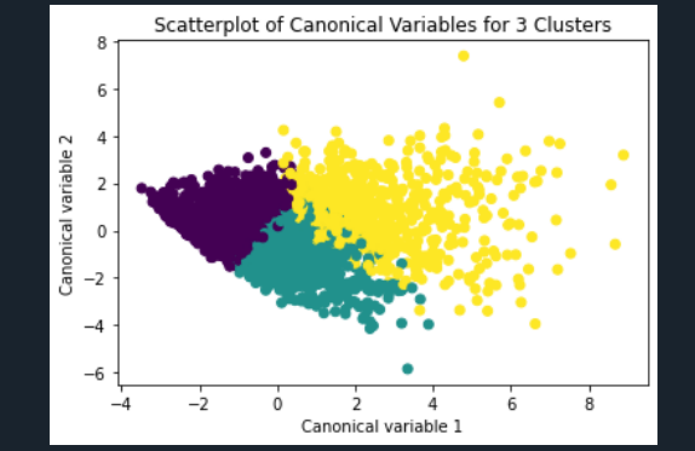

### Interpretation


Now we run the cluster analysis and ask for 3 clusters.

So we create an object, model 3, which will contain the results from the cluster analysis with 3 clusters.

```py
#now run it for 3 clusters
model3=KMeans(n_clusters=3,  n_init='auto')
model3.fit(clus_train)
clusassign=model3.predict(clus_train)

```

The first thing we want to try is to graph the clusters in a scatter plot to see whether or not they overlap with each other in terms of their location in the p dimensional space. However, with 11 clustering variables that means we have 11 dimensions, which would be impossible to visualize. A scatter plot will work to visualize a few dimensions, but not 11 dimensions. So what we're going to use is use canonical discriminate analysis, which is a data reduction technique that creates a smaller number of variables that are linear combinations of the 11 clustering variables.

The new variables, called canonical variables, are ordered in terms of the proportion of variance by each of the canonical variables. So the first canonical variable will count for the largest proportion of the variance. The second canonical variable will account for the next largest proportion of variance, and so on. Usually, the majority of the variance in the clustering variables will be accounted for by the first couple of canonical variables and those are the variables that we can plot. In Python, we can use the PCA function and the sklearn decomposition library to conduct the canonical discriminate analysis.


```py

#plot the graph
from sklearn.decomposition import PCA
pca_2 = PCA(2)
plot_columns = pca_2.fit_transform(clus_train)
plt.scatter(x=plot_columns[:,0], y=plot_columns[:,1], c=model3.labels_,)
plt.xlabel('Canonical variable 1')
plt.ylabel('Canonical variable 2')
plt.title('Scatterplot of Canonical Variables for 3 Clusters')
plt.show()
```


Here is the scatter plot. What this shows is that these two clusters (purple and green) are densely packed, meaning that the observations within the clusters are pretty highly correlated with each other, within cluster variance is relatively low. But they appear to have a good deal of overlap, meaning that there is not good separation between these two clusters.




On the other hand, the yellow cluster here shows better separation, but the observations are more spread out indicating less correlation among the observations and higher within cluster variance.


