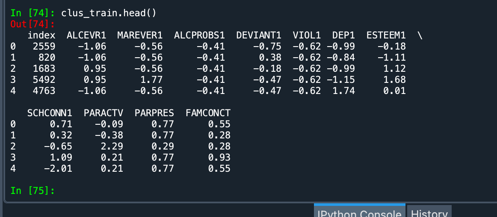
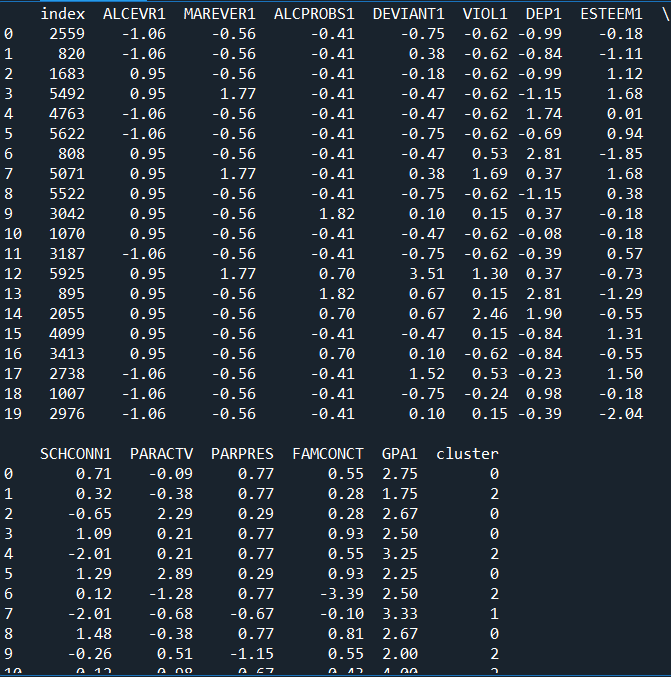
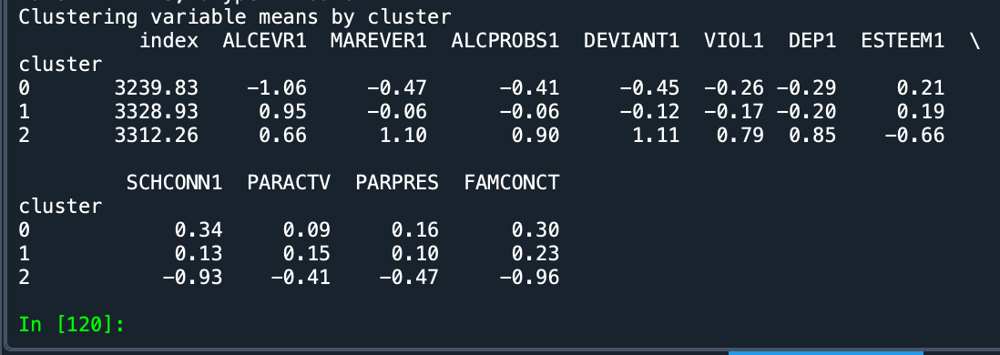

### Validating the Clusters

We can now use the GPA1 variable to help validate the clusters.

- First we need to create a unique identifier from the index for the cluster training data and then merge it with the cluster assignment variable so we have an id for each record and we know if that record went into cluster 0, cluster 1 or cluster 2.

```py
#work on cluster assignment with clustering variables to examine means by cluster.

#create a unique identifier variable from the index for the
#cluster training data to merge with the cluster assignment variable
#When we reset the index, the old index is added as a column, and a new sequential index #is used. You can see the new column called index.

clus_train.reset_index(level=0, inplace=True)
clus_train.head()

```




```py
#create a list that has the new index variable.
cluslist=list(clus_train['index'])
print(cluslist)

#create a list of cluster assignments
labels=list(model3.labels_)
print(labels)

#combine index variable list with cluster assignment list into a dictionary
newlist=dict(zip(cluslist, labels))
print(newlist)

#convert newlist dictionary to a dataframe, the original index becomes the new index and it has a single column containing the cluster allocation
newclus=DataFrame.from_dict(newlist, orient='index')
newclus.head(25)


#rename the cluster assignment column
newclus.columns=['cluster']

#create a unique identifier variable from the index for the
#cluster assignment dataframe
#to merge with cluster training data
newclus.reset_index(level=0, inplace=True)
newclus.head()

#merge cluster assignment dataframe with te cluster tainning variable dataframe#
#by the index variable

merged_train=pd.merge(clus_train, newclus, on='index')
merged_train.head(20)

```

This code produces a dataframe that contains a row for each observation in the training data, with all of the cluster variables and the number of the cluster the row is a member of.
We can see this in the first 20 rows.



- Now we can do the counts for each cluster.

```py
#cluster frequencies written two different ways
merged_train['cluster'].value_counts()
merged_train.cluster.value_counts()

#finally calculate clustering variable means by cluster
clustergrp = merged_train.groupby('cluster').mean()
print('Clustering variable means by cluster')
print(clustergrp)

```


**Cluster 2** shows .66 for ALCEVR1 showing a high likelihood of having used alcohol 
and 1.10 for use of Maijuana, they also have the highest levels of deviant behviour, depression, 
and the lowest self-esteem, and the lowest levels of school connectedness, parental presence, and family connectedness.

**Cluster 0** shows a low likelihood of using alcohol at -1.06 and low likelihood of 
using marijuana at -0.47. They had lowest levels in depression, deviant behaviour
and violence and highest levels of self esteem, family connectedness, parental 
presence and school connectedness.

*Remember your clustering output in the lab will be slightly different, but you should be still able to see one cluster with adolescents with issues and one without.
