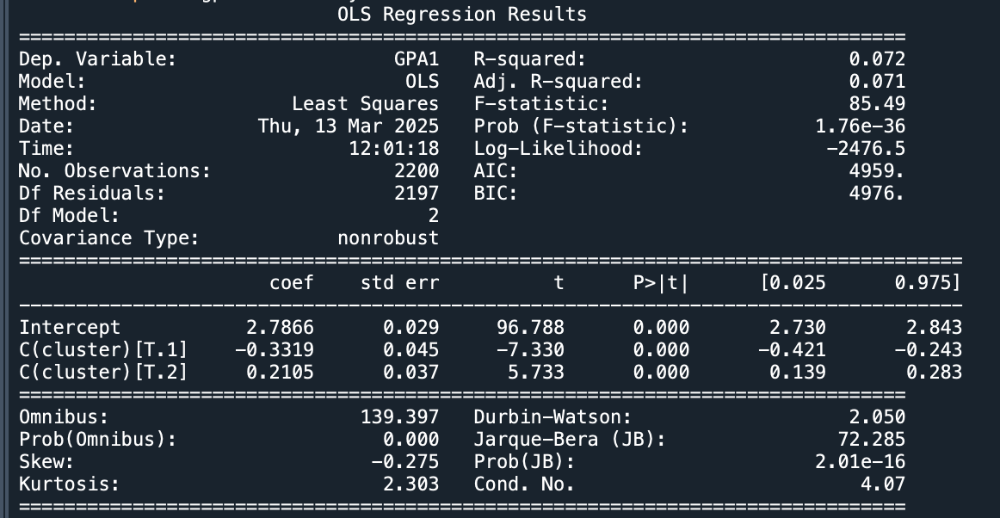
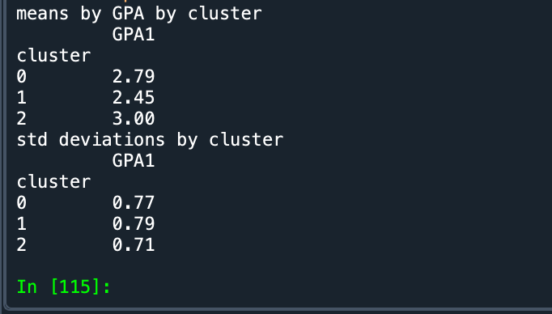

### Validating results

Now we look at the GPA results for each cluster.

``` py
#We first have to extract the GPA variable from the original data set, split the data into test and training datasets, and then merge the gpa training observations in the dataset that includes the cluster assignment variable with the training observations in the dataset that includes the clustering variables.


gpa_data = addhealth_data['GPA1']
gpa_data.head()
gpa_train, gpa_test = train_test_split(gpa_data, test_size=0.3, random_state=123)
gpa_train1=DataFrame(gpa_train)

gpa_train1.reset_index(level=0, inplace=True)
gpa_train1.head()
merged_train_all=pd.merge(gpa_train1, merged_train, on='index')
merged_train_all.head()

#we  create a new dataframe that only contains the two columns GPA1 and cluster
#with any rows that have NAN's removed.

sub1=merged_train_all[['GPA1','cluster']].dropna()
sub1.head()

#We'll use analysis of variance to test whether there are significant differences
#between clusters on the quantitative GPA variable.

#first we have to import in the statsmodels.formula.api and the
#statsmodels.stats.multicomp libraries. We use the ols function to test the
# analysis of variance (ANOVA).

import statsmodels.formula.api as smf
import statsmodels.stats.multicomp as multi

#remember the response variable goes first and then any catagory variables are
#noted by the 'C'
gpamod = smf.ols(formula='GPA1 ~ C(cluster)',data=sub1).fit()
print(gpamod.summary())
```



``` py
#We can also print the mean GPA and standard deviation for each cluster using the
#groupby function.

print('means by GPA by cluster')
m1=sub1.groupby('cluster').mean()
print(m1)

print('std deviations by cluster')
m2=sub1.groupby('cluster').std()
print(m2)
```



``` py
# Then, because our categorical cluster variable has three categories (0,1 and 2),
# we will request a tukey test to evaluate post hot comparisons between the clusters
# using the multi comparison function from the statsmodels.stats.multicomplibrary
# which we imported as multi.

mc1= multi.MultiComparison(sub1['GPA1'],sub1['cluster'])
res1=mc1.tukeyhsd()
print(res1.summary())

# Here are the results.
#The analysis of variance summary table indicates that the clusters differed
#significantly on GPA. When we examine the means, we find that not surprisingly,
#adolescents in cluster 0, the most troubled group, had the lowest GPA, and
#adolescents in cluster 2, the least troubled group, had the highest GPA.
#The tukey test shows that the clusters differed significantly in mean GPA
```

¬[](./img/08.png)
