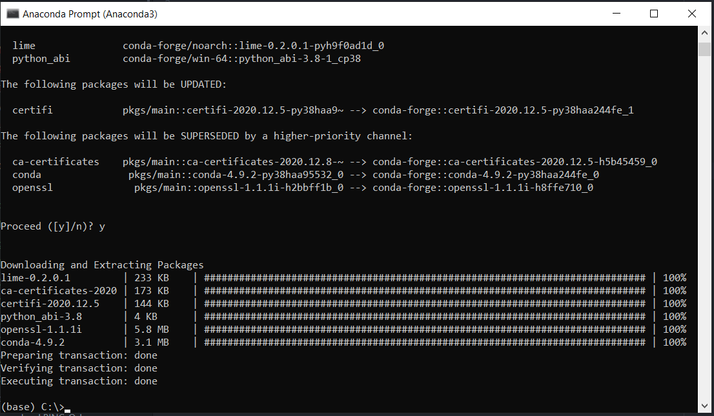
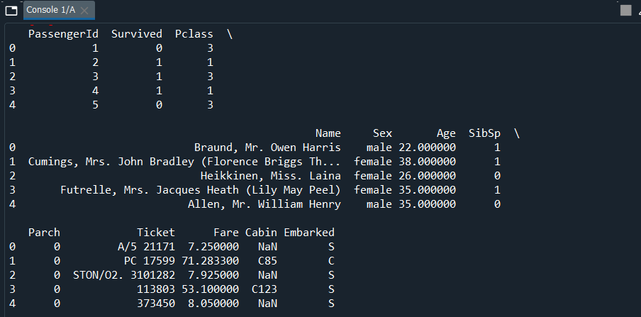
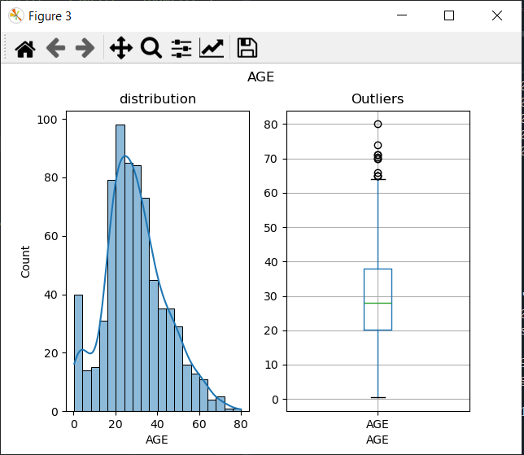

### 1. Classification


You may need to install another package in order to explain the classification.
Open the Anaconda command prompt and enter in the following code.

```
conda install -c conda-forge lime

```

Enter 'Y' when prompted. The package should then successfully install.




Next create a new python file in Spyder call it Lab09_classification.py

We need to import the following:

```py
#for data
import pandas as pd
import numpy as np
## for plotting
import matplotlib.pyplot as plt
import seaborn as sns
## for statistical tests
import scipy
import statsmodels.formula.api as smf
import statsmodels.api as sm
## for machine learning
from sklearn import model_selection, feature_selection, ensemble, linear_model, metrics
from sklearn.metrics import ConfusionMatrixDisplay

```


Next download the data file:

- [titanic data](./archives/data_titanic.csv)


Make sure you place the data file in the same directory as your Lab09_classification.py file.

Now we load the data.

```py

#read in the data
dtf = pd.read_csv('data_titanic.csv')
dtf.head()
```

The output should look like this:



Each row represents a specific passenger, details about the columns can be found through the link on the objectives page for this lab. There are 891 rows of data.

#### Data Management

As you have carried out in the past it is good to describe the data, investigate the number of variables, the count of rows, the types of data and if there is missing data. You also need to convert strings to numeric data to help with the analysis and output.
Write the code now to do this, it may look like this code below:

```py
#convert all columns names to uppercase
dtf.columns = map(str.upper, dtf.columns)


#set PANDAS to show all columns in Data frame
pd.set_option('display.max_columns', None)

#bug fix for display formats to avoid run time errors
pd.set_option('display.float_format',lambda x:'%f'%x)

print(dtf.describe())
print(dtf.dtypes)
print (len(dtf))
print (len(dtf.columns))
```
AGE and FARE are numerical variables, the rest are categorical.


The variable SURVIVED is the one we want to predict, we can rename it to be Y, it contains two classes, 1 if the passenger survived, and 0 is they did not. This is the binary classification we will use.


```py


#rename the classification variable to Y
dtf = dtf.rename(columns={"SURVIVED":"Y"})
```


#### Univariate plots

Using countplot from the seaborn library you can plot variable Y (if you renamed it from SURVIVED).

```py
#Univariate plot
#categorical
bc1 = sns.countplot(x='Y',data=dtf)
plt.xlabel('Died 0   Surrived 1')
plt.title('Passenger Survvial rates ')

```

Here you could also use groupby to count the number of passengers in each category for variable Y and calculate the percentages for those counts.
```py

#count of Y variable
print('count of Y Variable')
c1 = dtf.groupby('Y').size()
print(c1)

#percentages for Y variable
print('percentages of Y variable counts')
p1 = dtf.groupby('Y').size() * 100 /len(dtf)
print(p1)
```

Next we can use the histogram  to visualise the numerical variable AGE using displot.

```py

#Distplot for variable AGE
#numerical

bc2 = sns.displot(dtf.AGE.dropna(),kde=True)
bc2.set_titles('Distribution of age of passengers on the Titanic')
bc2.set_axis_labels('Age distribution','Count')


```

You could now also write the code to find the descriptive statistics for the AGE variable.

Lets create two charts for the AGE variable.

```py

#Create a figure of a distplot and a boxplot for age
fig, ax = plt.subplots(1,2)
fig.suptitle('AGE')
ax[0].title.set_text('distribution')
sns.histplot(dtf['AGE'].dropna(),kde=True, ax=ax[0])
plt.xlabel('AGE')
plt.title('')

ax[1].title.set_text('Outliers')
tmp_dtf = pd.DataFrame(dtf['AGE'])
#tmp_dtf['AGE'] = np.log(tmp_dtf['AGE'])
tmp_dtf.boxplot(column='AGE', ax=ax[1])
plt.show    


```

What do your charts show?

<!---
The passengers were, on average, pretty young: the distribution is skewed towards the left side (the mean is 30 years old and the 75th percentile is 38 years old).
-->

