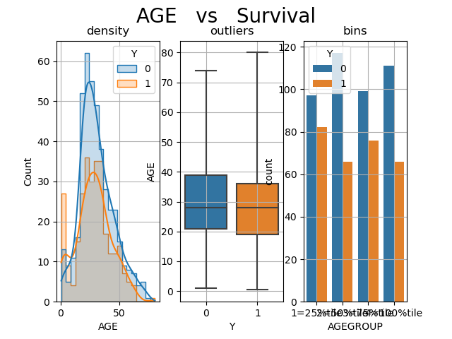
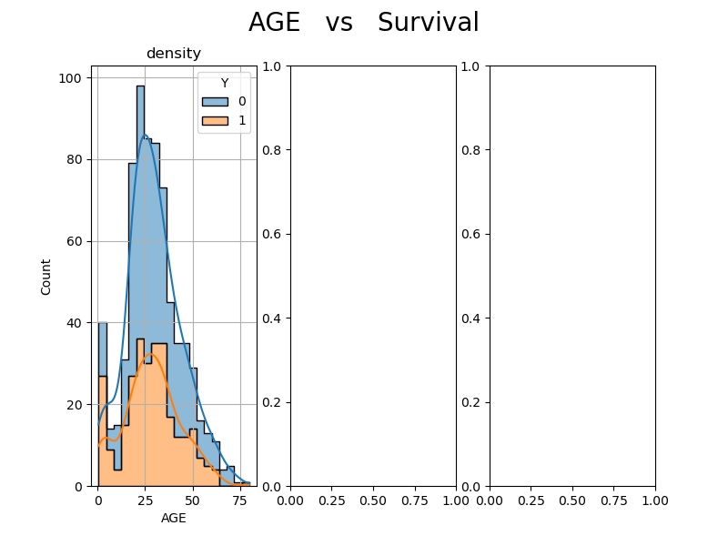

### 2. Bivariate

Now we look into the bivariate distribution to understand if Age has predictive power to predict Survival.

In other words the response varialbe is Survival (Y) and the indepdent variable is 
Age (X). You will do the following next:

- Plot and compare densities of those that died and those that survived.

- Plot AGE to show the spread and outliers of age of those who did and did not survive.

- Group the numerical variable (Age) into bins (AGEGROUP), count the values in each bin and output the results.

- Create a crosstab of AGEGROUP and SURVIVED

- Plot the composition of each bin


#### Setup

Create a figure that holds three plots as described above.



- First we setup the figure to contain 3 subplots and give it a title.
- Then we create the first chart, it will be a histplot (we can't use a displot inside a figure). We set the histplot to have AGE on the X axis and set the hue to be Y (SURVIVAL) so that two colours are used blue for those that did not survive and organge for those that did. (these colours are the default).

```py
#Bivariate plots
fig, ax = plt.subplots(nrows=1, ncols=3,  sharex=False, sharey=False, figsize=(8,6))
fig.suptitle('AGE   vs   Survival', fontsize=20)

### distribution
ax[0].title.set_text('density')
sns.histplot(dtf, x="AGE", multiple="stack", hue=dtf['Y'], element="step", kde=True, ax=ax[0])
ax[0].grid(True)
```
If you run this code you will see the first chart shows on the left.




- next we create the boxplot for Age

```py
##cat plot of AGE
ax[1].title.set_text('outliers')
sns.boxplot(x=dtf['Y'], y=dtf['AGE'], data=dtf, whis=np.inf, ax=ax[1])
ax[1].set_xlabel('SURVIVAL')
ax[1].grid(True)
```

- finally we create a new variable AGEGROUP and plot it on a bar chart.

```py
#create new variable AGEGROUP
dtf['AGEGROUP'] = pd.qcut(dtf['AGE'], 4, labels=['25%tile','50%tile','75%tile','100%tile'])
#show the counts for each group
print(dtf['AGE'].dtypes)
print(dtf['AGEGROUP'].dtypes)
c14= dtf['AGEGROUP'].value_counts(sort=False, dropna=True)
print(c14)

dtf.info()
#plot the third chart to show survival for each agegroup bin
dtf['Ystring'] = dtf['Y'].apply(str)
ax[2].title.set_text('bins')
ax[2] = sns.countplot(data=dtf, x=dtf['AGEGROUP'], hue=dtf['Ystring'],  ax=ax[2])
ax[2].set_xticklabels(ax[2].get_xticklabels(),  rotation=40,)
ax[2].grid(True)
plt.show()

```

What do these charts show?

<!-- if the proportion of 1s is similar in all of them then the variable is not predictive. -->
<!-- These 3 plots are just different perspectives of the conclusion that Age is predictive. The survival rate is higher for younger passengers: there is a spike in the left tail of 1s in the density chart and the first bin (25%) contains the highest percentage of survived passengers. -->

Lastly create a crosstab and interpret the output 

<!--to show the lower age group has the highest survival.-->
 
```py
#crosstab AGEGROUP and SURVIVED
print(pd.crosstab(dtf['AGEGROUP'],dtf['Y']))
```
