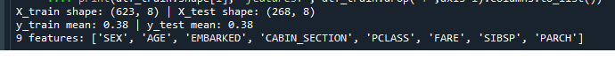

### 4. Preprocessing and Partitioning


We now know that AGE and SEX are examples of predictive features. Not all columns in the dataset are like that. We should investigate these too.

For example CABIN does not provide much useful information, there are many missing values and categories. However we can use the first letter of the cabin code to create a new variable that just holds the cabin section, this may be useful in predicting survival.

```py
## Create new column that holds the first character from the value in CABIN
dtf["CABIN_SECTION"] = dtf["CABIN"].apply(lambda x: str(x)[0])
print(dtf.head())

```
This code creates a new column called CABIN_SECTION that holds just the first character from the CABIN variable. Now we can see if cabin section is predictive.

We should carry out this analysis on each variable in the dataset to decide what variables should be kept as a potential feature and what can be dropped as it is not predictive.

#### Preprocessing

Data preprocessing is the phase of preparing the raw data to make it suitable for a machine learning model.

1. Each observation must be represented by a single row. In this dataset you can't in this case have the same passenger on two rows.
2. Each column should be a feature, so you shouldn't use PassengerId as a predictor.
3. The dataset must be partitioned into at least two sets: the model shall be trained on a significant portion of the dataset (called the "train set") and tested on a smaller set (called the "test set").
4. Missing values should be replaced with something, otherwise the model may throw errors.
5. Categorical data must be encoded, which means converting labels into integers, because machine learning expects numbers not strings.
6. It is good practice to scale the data, it helps to normalise the data within a particular range and speed up the calculations in an algorithm.

#### Partition dataset

When splitting data into train and test sets you follow 1 basic rule:

- rows in the train set shouldn't appear in the test set as well.

```py
#Next we start to preprocess the dataset ready for our machine learning model.

#first we create a subset without the columns passengerid, name, ticket, cabin, and agegroup as none of these are to be used as predictors.
dtf = dtf[['Y','SEX','AGE','EMBARKED','CABIN_SECTION','PCLASS','FARE','SIBSP','PARCH']]

#partitioning the dataset into train and test sets
dtf_train, dtf_test = model_selection.train_test_split(dtf,
                      test_size=0.3)
## print info
print("X_train shape:", dtf_train.drop("Y",axis=1).shape, "| X_test shape:", dtf_test.drop("Y",axis=1).shape)
print("y_train mean:", round(np.mean(dtf_train["Y"]),2), "| y_test mean:", round(np.mean(dtf_test["Y"]),2))
print(dtf_train.shape[1], "features:", dtf_train.drop("Y",axis=1).columns.to_list())

#check variables for nulls
dtf_train.isnull().sum()
dtf_test.isnull().sum()

#replace missing data in AGE with the average of the age in the training and test set.
dtf_train.loc[dtf_train['AGE'].isnull(), ['AGE']]=dtf_train['AGE'].mean()
dtf_test.loc[dtf_test['AGE'].isnull(), ['AGE']]=dtf_test['AGE'].mean()

#show that the missing values in AGE have been replaced
dtf_train.isnull().sum()
dtf_test.isnull().sum()
```



The output shows the split between each set is 623 rows in training with a mean of .37 of survival and 268 for the test set with a mean of .41 of survival.

- The AGE column contains some missing data that needs to be handled. We will use the average of the columns. It is correct to split into the training and test sets first and then replace NaN's with the average of the training set only.
