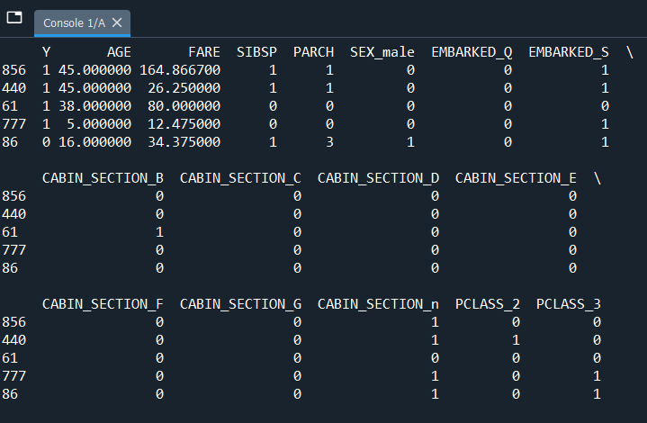
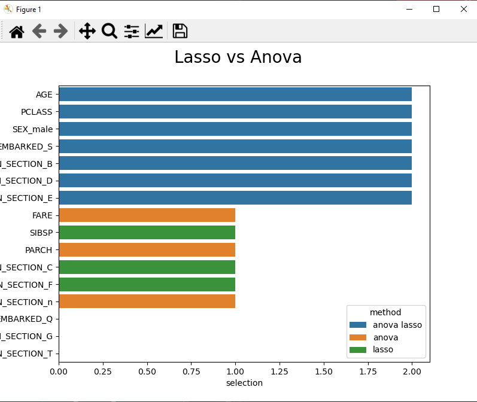
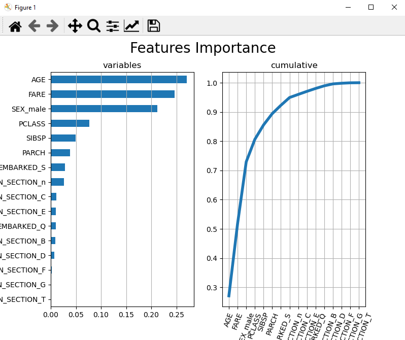

### 5. Encoding & Feature Engineering

Encoding and Scaling must be conducted on both the test and train datasets.

There are still some categorical data that should be encoded. The two most common encoders are the Label-Encoder (each unique label is mapped to an integer) and the One-Hot-Encoder (each label is mapped to a binary vector). The first one is suited for data with ordinality only. If applied to a column with no ordinality, like Sex, it would turn the vector [male, female, female, male, …] into [1, 2, 2, 1, …] and we would have that female > male and with an average of 1.5 which makes no sense.

On the other hand, the One-Hot-Encoder would transform the previous example into two dummy variables (dichotomous quantitative variables): Male [1, 0, 0, 1, …] and Female [0, 1, 1, 0, …]. It has the advantage that the result is binary rather than ordinal. We shall use the One-Hot-Encoding method, transforming 1 categorical column with n unique values into n-1 dummies.

The column SEX becomes a new column called SEX_male and holds either a True or False. This is carried out by the get_dummies function to perform one-hot encoding on each of the columns of interest.

```py
var_in_use = [
    'SEX',
    'EMBARKED',
    'CABIN_SECTION',
    'PCLASS'
    ]

#create dummy variables for each category in a catagorical variable
for i in var_in_use:
    dummy = pd.get_dummies(dtf_train[i], 
                       prefix=i,drop_first=True)
    dtf_train= pd.concat([dtf_train, dummy], axis=1)
    print( dtf_train.filter(like=i, axis=1).head() )
    
## drop the original categorical columns
dtf_train.drop(columns=['SEX','CABIN_SECTION','EMBARKED','PCLASS'], inplace=True, axis=1)
print(dtf_train.head())

#create dummy variables for each category in a catagorical variable
for i in var_in_use:
    dummy = pd.get_dummies(dtf_test[i], 
                       prefix=i,drop_first=True)
    dtf_test= pd.concat([dtf_test, dummy], axis=1)
    print( dtf_test.filter(like=i, axis=1).head() )


## drop the original categorical columns
dtf_test.drop(columns=['SEX','CABIN_SECTION','EMBARKED','PCLASS'], inplace=True, axis=1)
print(dtf_test.head())
```



#### Feature Selection

Feature selection is the process of selecting a subset of relevant variables to build the machine learning model. It makes the model easier to interpret and reduces overfitting (when the model adapts too much to the training data and performs badly outside the train set).

We already excluded irrelevant columns. Now it’s going to be a bit different because we assume that all the features in the matrix are relevant and we only want to drop the unnecessary ones.

When is a feature not necessary? Well, the answer is easy: when there is a better equivalent, or one that does the same job but better.

For example: Pclass is highly correlated with Cabin_section because certain sections were located in 1st class and others in the 2nd. We may decide to keep one of these features and not the other.

Two different ways to perform automatic feature selection: regularization method compared to ANOVA test, and an ensemble method.

#### Regularization (compares anova to lasso)

LASSO regularization is a regression analysis method that performs both variable selection and regularization in order to enhance accuracy and interpretability.


```py
#Feature Selection using Lasso regularisation
#first place all the feature values into x
X = dtf_train.drop("Y", axis=1).values

#next place all the survvial values into y
y = dtf_train["Y"].values

#then place all the columns names except Y into feature_names
feature_names = dtf_train.drop("Y", axis=1).columns

## Use Anova to choose the best features
selector = feature_selection.SelectKBest(score_func=  
              feature_selection.f_classif, k=10).fit(X,y)
anova_selected_features = feature_names[selector.get_support()]

## Use Lasso regularization to choose the best features
selector = feature_selection.SelectFromModel(estimator=
              linear_model.LogisticRegression(C=1, penalty="l1",
              solver='liblinear'), max_features=10).fit(X,y)
lasso_selected_features = feature_names[selector.get_support()]

 
## Plot the barplot showing the feature selections
fig, ax = plt.subplots(nrows=1, ncols=1,  sharex=False, sharey=False, figsize=(8,6))
fig.suptitle('Lasso vs Anova', fontsize=20)

#first create a dataframe that holds the feature names
dtf_features = pd.DataFrame({"features":feature_names})

#add another column where the feature name is present in the anovva feature list and place the value anova in that column
dtf_features["anova"] = dtf_features["features"].apply(lambda x: "anova" if x in anova_selected_features else "")

#add another column called num1 where a feature name is in the anova feature list, place 1 if it is, 0 if it isn't
dtf_features["num1"] = dtf_features["features"].apply(lambda x: 1 if x in anova_selected_features else 0)

#add another column where the feature name is present in the lasso feature list and place the value anova in that column
dtf_features["lasso"] = dtf_features["features"].apply(lambda x: "lasso" if x in lasso_selected_features else "")

#add another column called num2 where a feature name is in the lasso feature list, place 1 if it is, 0 if it isn't
dtf_features["num2"] = dtf_features["features"].apply(lambda x: 1 if x in lasso_selected_features else 0)

#add another column called method, place in there either anova or lasso or anova lasso fom those new columns called anova and lasso
dtf_features["method"] = dtf_features[["anova","lasso"]].apply(lambda x: (x[0]+" "+x[1]).strip(), axis=1)

#finally create another column called selection that adds together the values in num1 and num2
dtf_features["selection"] = dtf_features["num1"] + dtf_features["num2"]

#view the contents of dtf_features to see al lthe new columns
dtf_features

#plot the cahrt to show the features that were selected in anova, lasso and in both.
sns.barplot(ax=ax, y="features", x="selection", hue="method", data=dtf_features.sort_values("selection", ascending=False), dodge=False)

```


The blue features are the ones selected by both ANOVA and LASSO, the others are selected by just one of the two methods.

#### Random Forest - an ensemble method

Random forest is an ensemble method that consists of a number of decision trees in which every node is a condition on a single feature, designed to split the dataset into two so that similar response values end up in the same set. A features importance is computed from how much each feature decreases the entropy in a tree.

```py
#Ensemlbe method - Random Forest
#first get all the feature values
X = dtf_train.drop("Y", axis=1).values

#next all the Y survival values
y = dtf_train["Y"].values

#then place all the columns names except Y into feature_names
feature_names = dtf_train.drop("Y", axis=1).columns.tolist()

## Importance - random forests classifier
model = ensemble.RandomForestClassifier(n_estimators=100,
                      criterion="entropy", random_state=0)
model.fit(X,y)
importances = model.feature_importances_


## Put in a pandas dtf, 2 variables in the data frame, IMPORTANCE and VARIABLE sorted by importance.
dtf_importances = pd.DataFrame({"IMPORTANCE":importances,
            "VARIABLE":feature_names}).sort_values("IMPORTANCE",
            ascending=False)

## cummulative sum
#using the function cumsum to create add the values in importance so a cumulative sum value exists for each row
dtf_importances['cumsum'] =  dtf_importances['IMPORTANCE'].cumsum(axis=0)

##set the index to VARIABLE column
dtf_importances = dtf_importances.set_index("VARIABLE")

## Plot on a fig with two columns
fig, ax = plt.subplots(nrows=1, ncols=2, sharex=False, sharey=False, figsize=(8,6))
fig.suptitle("Features Importance", fontsize=20)

#first chart is a bar plotting variables by importance
ax[0].title.set_text('variables')
dtf_importances[["IMPORTANCE"]].sort_values(by="IMPORTANCE").plot(
                kind="barh", legend=False, ax=ax[0]).grid(axis="x")
ax[0].set(ylabel="")

##second chart is a line showing cumulative importance.
ax[1].title.set_text('cumulative')
dtf_importances[["cumsum"]].plot(kind="line", linewidth=4,
                                 legend=False, ax=ax[1])
ax[1].set(xlabel="", xticks=np.arange(len(dtf_importances)),
          xticklabels=dtf_importances.index)
plt.xticks(rotation=70)
plt.grid(axis='both')
plt.show()
```
The charts should look like this:




It's interesting that AGE and FARE are the most important features this time, they weren't the top features before and that Cabin_section E, F and D don't appear really useful here.
