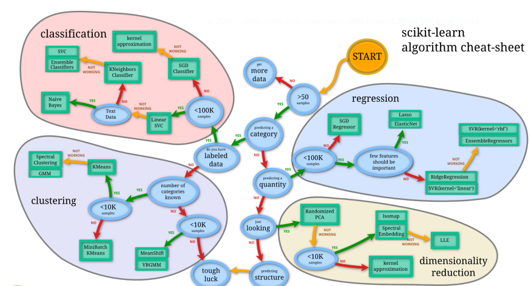
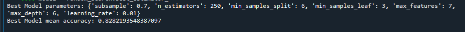

### 6. Design, train, and test machine learning model.


It is a good idea to use as few features as possible in order to move on with the design, train, test and evaluation of the machine learning model.

The following were selected by both LASSO and Anova so they are included:

- Age
- PClass
- Sex
- Embarked_s
- Cabin section D and E

 along with those that were selected by Anova or Lasso on their own and by Random Forest method

- FARE
- SIBSP
- PARCH
- cabin sections C and N

```py
#Select the following features, train and test
print(dtf_train.head())
X_names = ["AGE", "FARE", "SEX_male", "SIBSP", "PCLASS_3", "PARCH",
"CABIN_SECTION_n", "EMBARKED_S", "PCLASS_2", "CABIN_SECTION_F", "CABIN_SECTION_E", "CABIN_SECTION_D"]

#traing dataset x and y values
X_train = dtf_train[X_names].values
y_train = dtf_train["Y"].values

#testing dataset x and y values
X_test = dtf_test[X_names].values
y_test = dtf_test["Y"].values
```

#### Model design

Finally, it’s time to build the machine learning model. First, we need to choose an algorithm that is able to learn from training data how to recognize the two classes of the target variable by minimizing some error function.

It is a good idea to always try a gradient boosting algorithm (like XGBoost). It’s a machine learning technique that produces a prediction model in the form of an ensemble of weak prediction models, typically decision trees. Basically it’s similar to a Random Forest with the difference that every tree is fitted on the error of the previous one.

There are a lot of parameters and no general rule about what is best, so you just have to find the right combination that fits your data best. The following code uses RandomSearch for the hyperparameter tuning: it iterates through the data finding the combination of parameters that maximises a scoring function (accuracy, number of correct predictions).



```py
#Designing the model requires figuring out what parameter settings to use

model = ensemble.GradientBoostingClassifier()

## define hyperparameters combinations to try
param_dic = {'learning_rate':[0.15,0.1,0.05,0.01,0.005,0.001],      #weighting factor for the corrections by new trees when added to the model
'n_estimators':[100,250,500,750,1000,1250,1500,1750],  #number of trees added to the model
'max_depth':[2,3,4,5,6,7],    #maximum depth of the tree
'min_samples_split':[2,4,6,8,10,20,40,60,100],    #sets the minimum number of samples to split
'min_samples_leaf':[1,3,5,7,9],     #the minimum number of samples to form a leaf
'max_features':[2,3,4,5,6,7],     #square root of features is usually a good starting point
'subsample':[0.7,0.75,0.8,0.85,0.9,0.95,1]}       #the fraction of samples to be used for fitting the individual base learners. Values lower than 1 generally lead to a reduction of variance and an increase in bias.

## random search
#RandomSearch helps to find the best combination of parameters and puts them into the model using the X_train and Y_train datasets this may take several minutes to run.

random_search = model_selection.RandomizedSearchCV(model,
       param_distributions=param_dic, n_iter=100,
       scoring="accuracy").fit(X_train, y_train)

print("Best Model parameters:", random_search.best_params_)
print("Best Model mean accuracy:", random_search.best_score_)
model = random_search.best_estimator_

```
This takes several minutes to complete.
It should return something like the following (it will vary as it is a random search):



So now we have the best model, it has a mean accuracy of 0.83, so probably 83% of predictions on the test set will be correct.

Include in your document to submit an image of the output with your interpretation. 
