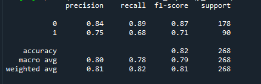
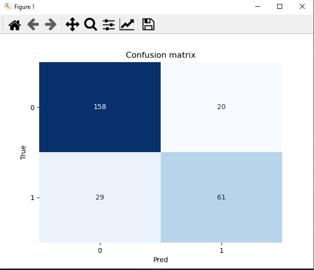
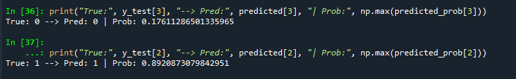

### 7. Evaluation

We will proceed and use the model selected by the RandomSearch.

```py
#use the model now
model.fit(X_train, y_train)

## test
predicted_prob = model.predict_proba(X_test)[:,1]
predicted = model.predict(X_test)
```

A default threshold of 0.5 is used here. So on the test data a value of .5 would be predicted to be considered as 1.

The area under the Receiver Operating Characteristic or ROC curve, also called the AUC, is the most widely used performance metric for binary classification models.

Its two great strengths are, first, that AUC results do not change if there are changes in the incidents of the actual condition, nor is AUC affected by changes in the relative cost of the two different types of binary classification errors, false positives and false negatives. Therefore when either future incidents or the cost of classification errors or both are unstable or cannot be known, the AUC is generally the best possible performance metric available.

The AUC metric ranges from a minimum of one-half (.5) to a maximum of one. An AUC of one-half indicates total uncertainty about classification. An AUC of one would be classification with zero errors, a theoretical ideal that no one expects you to meet. A normal good to very good area under the curve is typically in the .65 to .85 range.

Our model has been trained and has a mean accurcy rate of .83, we can now also calculate the AUC for our model.

```py
#Evaluation: AUC, Precision and Recall
## Accuray e AUC
accuracy = metrics.accuracy_score(y_test, predicted)
auc = metrics.roc_auc_score(y_test, predicted_prob)
print("Accuracy (overall correct predictions):",  round(accuracy,2))
print("Auc:", round(auc,2))

## Precision and Recall
recall = metrics.recall_score(y_test, predicted)
precision = metrics.precision_score(y_test, predicted)
print("Recall (all 1s predicted right):", round(recall,2))
print("Precision (confidence when predicting a 1):", round(precision,2))
print("Detail:")
print(metrics.classification_report(y_test, predicted, target_names=[str(i) for i in np.unique(y_test)]))

```
*Your results will be slightly different as the model used RandomSearch for the parameters in the model design. So the following interpretation is on my model.*
*For this lab you should report on your model in your document for submitting to Moodle.*


- The general accuracy of the model is around 82% (see the row labelled accuracy and the value is on the right.

*The recall (True positive rate) column tells us how many true positives or true negatives were predicted correctly.*

- 68% of actual survivors were correctly predicted.
- 89% of acutal deaths were correctly predicted.

*Precision tells us of the predicted positives the number that are true positives.*

- 75% of predicted survivors were correct
- 84% of predicted deaths were correct

We could say that the model is more accurate at predicting death!



A confusion matrix helps to understand the metrics better.

```py
#confusion matrix
#confusion matrix
classes = np.unique(y_test)
cm = metrics.confusion_matrix(y_test, predicted, labels=classes)
disp = ConfusionMatrixDisplay(confusion_matrix=cm, display_labels=classes)
disp.plot()

```


We can see that the model predicted 81 (61+20) 1s of which 61 are true positives and 20 are false positives, so it has a Precision of 61/81 = 0.75 when predicting 1s.


On the other hand, the model got 61 1s right of all the 90 (61+29) 1s in the test set, so its Recall is 61/90 = 0.68.

*Recall tells us of all the true positives in the set how many were correctly predicted positive*

Choosing a threshold of 0.5 to decide whether a prediction is a 1 or 0 led to this result. Would it be different with another one? Definitely yes, but there is no threshold that would bring the top score on both precision and recall, choosing a threshold means to make a compromise between these two metrics.


If we want to increase the recall (so predicting more true positives) it impacts on the false positives as they will increase. The threshold you choose depends on the scenario of use, and whether a false positive has a higher cost than a false negative.

```py
# test the prediction on random observation from the test set and see what is predicted.
print("True:", y_test[2], "--> Pred:", predicted[2], "| Prob:", np.max(predicted_prob[2]))
print("True:", y_test[3], "--> Pred:", predicted[3], "| Prob:", np.max(predicted_prob[3]))
```



The model predicted observation 3 to be negative (0), and it was negative, the probability of it being positive is 18%.

The model predicted observation 2 to be positive (1), and it was positive, the probability of it being positive is 89%.


- pick 2 observations like 2 & 3 above, find one which is truely negative and was predicted negative, then find one which is truely positive and was predicted posititve. 

**again your results for these observations will be different as your observation 3 may not be negative and observation 2 may not be positive. Keep trying numbers to see what observations in your analysis are negative/positive**

